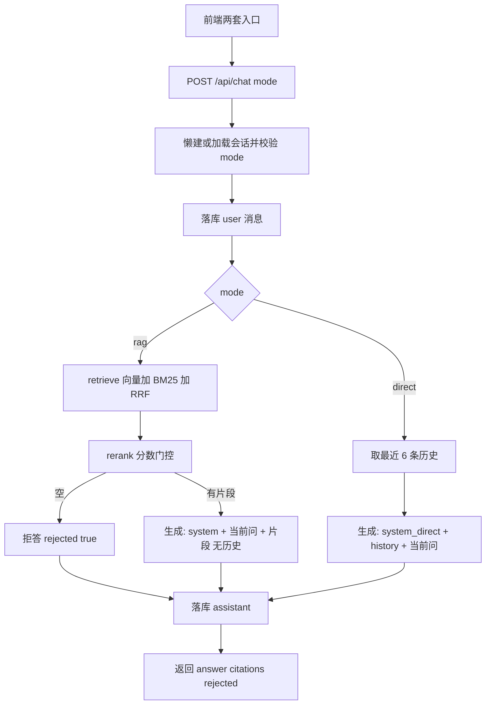

# Knowledge Hub — 双模式对话技术方案设计文档

- **日期**：2026-10-14
- **状态**：已实现（待验收）
- **作者**：项目组
- **功能短名**：`chat-dual-mode`
- **对应主文档**：[knowledge-qa-design.md](./knowledge-qa-design.md)
- **说明**：在现有「知识库问答（RAG）」之外，增加独立的「自由对话（纯 LLM）」入口；用户显式选择模式；同一会话一种模式，不允许混聊。

---

## 1. 定位与目标

Knowledge Hub 当前对话入口固定走混合检索 → Rerank → 拒答 / 带引用生成。本功能在**不改动 RAG 检索链路本体**的前提下，增加第二条路径：完全跳过检索，直接调用 LLM。

**目标能力**：

- 用户在顶栏常驻切换「知识库问答 | 自由对话」
- 同接口 `POST /api/chat` 通过 `mode` 区分行为：`rag` / `direct`
- 会话级绑定模式：懒建时写入 `mode`，续聊必须一致
- 会话列表按 `mode` 过滤，两套前端入口各自只展示本模式历史
- `rag`：检索链路不变；**生成不再携带对话历史**（仅当前问题 + 检索片段）
- `direct`：不碰检索；**携带最近 6 条多轮历史**；无引用、不拒答

**交付目标**：本地可演示两种模式；样式与现有对话页一致；`rag` 仍可引用/拒答，`direct` 可多轮闲聊。

---

## 2. 范围与非目标

### 2.1 范围内

| 层 | 内容 |
|----|------|
| 数据 | 系统相关表前缀改为 `sys_`（业务表去掉 kh_ 前缀）；`conversation` 增加 `mode` |
| API | `ChatRequest.mode`；列表 `?mode=`；会话响应带 `mode`；混聊校验 |
| 后端 | 系统表 ORM/`__tablename__`/注释同步为 `sys_*`；`ask` 按 mode 分支；`rag` 去掉生成历史；`direct` 直调 LLM |
| 前端 | 顶栏双入口；路由 `/chat/rag` 与 `/chat/direct`；两套 View/Store |

### 2.2 非目标（本规格不做）

- SSE / 流式输出
- 按钮级权限拆分（如 `chat:free`）；仍只验已登录 + ACTIVE
- 私有文档库 / 按文档 ACL 检索
- `direct` 独立模型、独立 temperature 配置（共用现有 `LLM_*`）
- 同一会话内切换模式或混用历史
- **`rag` 多轮指代理解（有意变更现网行为）**：知识库问答定位为「每轮独立、只答当前问题」——生成侧**不**把此前问答拼进 prompt。指代续问（如先问「年假怎么申请」再问「需要审批吗」）依赖检索命中当前问句本身；需要多轮上下文时使用 **`direct`**。理由：缩小 rag 幻觉面、避免历史与检索片段争抢上下文；多轮闲聊能力由 `direct` 承担。详见 §6.3、验收 A3。

---

## 3. 数据流



**要点**：

- 检索**始终只用当前用户消息原文**，不拼历史。
- `rag` 生成侧**有意不带历史**（相对现网行为变更，见 §2.2）；`direct` 生成侧带最近 6 条。
- `direct` **不调用** `retrieve` / `rerank` / Embedding。

---

## 4. 数据模型

### 4.0 表名约定：系统表 `sys_*`，业务表无 `kh_` 前缀

库名 `knowledge_hub` 不变。API 路径与 JSON 字段名不受影响。

**系统表**（账号 / RBAC）：

| 现表名 | 新表名 |
|--------|--------|
| `kh_user` | `sys_user` |
| `kh_role` | `sys_role` |
| `kh_permission` | `sys_permission` |
| `kh_user_role` | `sys_user_role` |
| `kh_role_permission` | `sys_role_permission` |

**业务表**（去掉 `kh_`）：

| 现表名 | 新表名 |
|--------|--------|
| `kh_document` | `document` |
| `kh_chunk` | `chunk` |
| `kh_conversation` | `conversation` |
| `kh_message` | `message` |

**非 MySQL**：Chroma collection 仍为 `kh_chunks`（不改）。

**ORM / 迁移**：[`backend/app/models/`](../backend/app/models/) 的 `__tablename__` 与上表一致；存量库执行 [`scripts/migrate_chat_dual_mode.py`](../scripts/migrate_chat_dual_mode.py)（幂等）。`create_all` 不会自动 rename，必须跑迁移脚本。

### 4.1 `conversation` 变更（加 `mode`）

新增字段：

| 列 | 类型 | 约束 | 说明 |
|----|------|------|------|
| `mode` | VARCHAR(32) | NOT NULL，DEFAULT `'rag'` | 会话模式：`rag` \| `direct` |

- **存量迁移（明确用 DB 加列，不用「仅 ORM 默认值」）**：对已有库执行等价于：

  ```sql
  ALTER TABLE conversation
    ADD COLUMN mode VARCHAR(32) NOT NULL DEFAULT 'rag' COMMENT '会话模式：rag | direct';
  ```

  字符集 / 注释等按项目现有迁移风格补全即可。**新列加在表末尾**，不指定 `AFTER` / `FIRST`，避免与现有列顺序耦合。存量行在 DB 层自动填 `rag`；应用查询**不**处理 `NULL` 分支。ORM 模型与之一致（`nullable=False`，server/default `'rag'`），但不以「只改 ORM、库内仍可能 NULL」作为迁移策略。
- **消息表 `message` 不增加 `mode`**：模式以会话为准。

### 4.2 会话序列化

列表项与详情中的 `conversation` 对象增加：

```json
{ "id": 1, "title": "...", "mode": "rag", "createdAt": "...", "updatedAt": "..." }
```

（字段命名风格与现有 camelCase 响应对齐。）

---

## 5. API 约定

统一响应外壳不变：`{ "code": 0, "message": "success", "data": ... }`。鉴权：`Bearer` JWT，与现网一致。

### 5.1 `POST /api/chat`

**请求体**（扩展 [`ChatRequest`](../backend/app/schemas/chat.py)）：

| 字段 | 类型 | 说明 |
|------|------|------|
| `message` | string | 必填，非空 |
| `conversationId` | int \| null | 缺省则懒建 |
| `mode` | string | `rag` \| `direct`；缺省时按 **`rag`**（兼容旧客户端） |

**行为**（`mode` 先按 §5.4 规范化：缺失 / `null` → `rag`，再比会话）：

| 场景 | 行为 |
|------|------|
| `conversationId` 为空 | 新建会话，写入规范化后的 `mode`，`title` 仍为首问截断 |
| `conversationId` 有值且规范化后 `mode` 与会话一致 | 续聊 |
| `conversationId` 有值且规范化后 `mode` 与会话不一致 | 拒绝，**不写** user/assistant 消息 |
| 规范化前为非空且非 `rag`/`direct`（如 `""`、`foo`） | 拒绝（§5.4），不写消息 |

**响应 `data`**（字段与现网对齐，语义按 mode）：

| 字段 | rag | direct |
|------|-----|--------|
| `conversationId` | 有 | 有 |
| `messageId` | 有 | 有 |
| `answer` | 生成或拒答文案 | LLM 回复 |
| `rejected` | 依据不足时 `true` | 恒为 `false` |
| `citations` | 有则非空数组 | 恒为 `[]` |

### 5.2 `GET /api/conversations`

| 查询参数 | 说明 |
|----------|------|
| `mode` | 可选；传 `rag` / `direct` 时**仅返回该模式**会话；**查询参数缺省时默认按 `rag` 过滤**（与旧前端兼容，见下） |

排序仍按 `updated_at` 倒序；仅本人。

**兼容说明（已拍板）**：现网前端 [`listConversations`](../frontend/src/api/chat.js) **不传** `mode`。若「不传返回全部」，旧前端列表会混入 `direct` 会话并可能误开导致混聊 `40001`。因此列表接口与 `POST /api/chat` 对齐：**不传 `mode` → 只返回 `rag` 会话**。新前端两套入口均**显式**传 `mode=rag` 或 `mode=direct`。本规格不提供「一次返回全部模式」的列表能力；调试需要时分两次请求即可。非法 `mode` 查询值同 §5.4 报 `40001`。

### 5.3 其余会话 API

- `GET /api/conversations/{id}`：详情含 `conversation.mode`；非本人 → `40401`。**本接口不按 mode 过滤**（知 id 即可读到本人任意模式会话）。前端两套页面打开详情后须校验 `conversation.mode` 与当前页一致，不一致则提示并退回本模式列表，勿把 `direct` 会话渲染进 rag 页（或反之）。
- `PATCH` / `DELETE`：行为不变；不修改 `mode`

### 5.4 错误约定

| 场景 | 建议 |
|------|------|
| 请求**未传** `mode`（JSON 字段完全缺失） | **不视为非法**：按 §5.1 默认 `rag`，不报错 |
| 请求**显式** `mode: null` | **同样视为缺省** → `rag`，不报错；实现时勿把 `null` 当成非法枚举 |
| 请求**传了**非空 `mode` 但不是 `rag` / `direct`（如 `""`、`foo`） | 新增业务码 `40001`（参数错误），HTTP 400，message 如「无效的对话模式」 |
| 会话 mode 与请求不一致 | 同用 `40001`，message 如「会话模式不匹配，不允许混聊」 |
| 会话不存在 / 非本人 | 沿用 `40401` |
| LLM / Embedding 失败 | 沿用 `50010`（`direct` 仅 LLM；`rag` 同现网） |

实现顺序：先规范化「字段缺失或 `null` → `rag`」，再校验「已解析的非空字符串是否属于枚举」；**缺省 / `null` 不得走进非法分支**。在 [`ErrorCode`](../backend/app/common/errors.py) 增加 `BAD_REQUEST = 40001`（或等价命名），勿复用 `INTERNAL` 表达参数错误。列表 Query 的 `mode` 缺省同理（§5.2 → 按 `rag` 过滤）。

---

## 6. 后端改动落点

不平行另起目录；在现有 chat / qa 上扩展。

| 文件 | 改动 |
|------|------|
| [`user.py`](../backend/app/models/user.py)、[`rbac.py`](../backend/app/models/rbac.py) | `__tablename__` → `sys_*`；注释同步（§4.0） |
| 其余 models（document/chunk/conversation/message） | **表名不动**；仅 conversation 增加 `mode`；注释里若引用用户表则改为 `sys_user` |
| [`backend/app/schemas/chat.py`](../backend/app/schemas/chat.py) | `ChatRequest.mode`；可选 Literal / 校验 |
| [`backend/app/api/chat.py`](../backend/app/api/chat.py) | 传入 `mode`；列表接收 `mode` Query |
| [`backend/app/services/chat.py`](../backend/app/services/chat.py) | 懒建写 mode；续聊校验；`list_conversations` 过滤；`ask` 分支 |
| [`backend/app/services/qa.py`](../backend/app/services/qa.py) | `rag`：生成接口不接收 / 不拼接 history；新增 `generate_direct_answer`（占位 system + history + 当前问） |
| [`backend/app/common/errors.py`](../backend/app/common/errors.py) | `BAD_REQUEST = 40001` |
| DB | 系统表 → `sys_*`；业务表去 `kh_`；`conversation` 表末尾加 `mode`（§4.0 / §4.1） |

### 6.1 `ask` 分支逻辑（摘要）

1. 校验 `message`、规范化 `mode`（字段缺失或 `null` → `rag`）
2. 懒建 / 加载会话并校验 mode
3. 落库 user 消息
4. **`mode == "rag"`**  
   - **不查询**对话历史（禁止「先取再丢弃」）；从现网公共「取最近 6 条」步骤中拆出，仅 `direct` 走查询  
   - `retrieve` → `rerank_chunks` → 空则拒答，否则 `generate_answer`（无 history 参数或内部不拼历史）  
5. **`mode == "direct"`**  
   - 取当前消息之前最近 **6** 条，时间正序（与现网一致：`Message.id < 当前 user 消息 id`，避免把本轮 user 再拼进 history）  
   - `generate_direct_answer(history, question)`  
   - 响应 `rejected=false`，`citations=[]`  
6. 落库 assistant 并返回

### 6.2 Prompt

| 模式 | System |
|------|--------|
| rag | 保持现有企业知识库助手 + 引用规范（[`qa.py`](../backend/app/services/qa.py)） |
| direct | 占位即可，例如：「你是通用对话助手，可进行多轮闲聊与常识问答，不依赖企业知识库。」 |

本阶段不强制独立配置键；后续若需再拆 `LLM_TEMPERATURE` 等。

### 6.3 历史策略对照

| 模式 | 检索是否用历史 | 生成是否用历史 |
|------|----------------|----------------|
| rag | 否 | **否**（有意变更现网：去掉最近 6 条；见 §2.2） |
| direct | 不检索 | **是**（最近 6 条） |

产品含义：`rag` 会话仍可在 UI 展示多轮消息气泡，但每一轮生成**彼此独立**；指代续问请用 `direct`，或把指代写进当前问句再走 `rag`。

---

## 7. 前端改动落点

### 7.1 导航与路由

| 项 | 约定 |
|----|------|
| 顶栏 | [`App.vue`](../frontend/src/App.vue)：常驻「知识库问答」「自由对话」（可保留「文档」）；去掉或替换原单一「对话」链 |
| 路由 | `/chat/rag` → rag 页；`/chat/direct` → direct 页；`/chat` 重定向到 `/chat/rag`；默认登录落地 `/chat/rag` |

切换 Tab = 切换路由进入另一套页面，**不**把当前会话 ID 带到另一模式。

**产品提示（与 §6.3 对齐）**：rag 页多轮气泡仅为历史展示，**不构成生成上下文**。rag 页勿做「基于上文的联想输入 / 续写提示 / 暗示系统记得指代」等功能，以免用户误以为系统记得上文；指代续问引导用户使用「自由对话」。

### 7.2 两套页面 / Store

按「前端搞两套」隔离状态，避免 mode 串台：

| 模式 | 建议路径 |
|------|----------|
| rag | 现有 [`ChatView.vue`](../frontend/src/views/chat/ChatView.vue) + [`stores/chat.js`](../frontend/src/stores/chat.js)（固定 `mode: 'rag'`） |
| direct | 新增如 `views/chat/DirectChatView.vue` + `stores/directChat.js`（固定 `mode: 'direct'`） |

可复用组件：`ChatInput`、消息气泡列表。direct 空态文案单独一套（不写「知识库引用」）。

**现网缺口（实现必拆）**：当前 [`MessageList.vue`](../frontend/src/components/chat/MessageList.vue) **已内嵌** `CitationList`、拒答文案，且空态写死「附带知识库引用」。不能原样给 direct 复用。实现时须拆成无引用的通用列表（或 props/插槽注入引用与空态），使 direct 页**零 import** `CitationList` / 拒答 UI。

**CitationList / 拒答**：仅 rag 页使用。direct 页**直接不 import / 不挂载**（不要「引入了再 `v-if` 隐藏」）；后端虽返回 `rejected=false`、`citations=[]`，前端无需为这两字段做展示分支。

**复用约束**：可复用组件须为**无状态展示 / 交互组件**——不直接读取某个 Pinia store；消息列表、禁用态、发送回调、空态文案等一律由父页面通过 **props / emit / 插槽** 传入。两套 View 各自绑定自己的 store。

### 7.3 API 调用

[`frontend/src/api/chat.js`](../frontend/src/api/chat.js)：

- `askChat`：body 带 `mode`（缺失与 `null` 由后端视为 `rag`；新前端应显式传）
- `listConversations`：`params: { mode }`（新前端显式传；不传时后端按 §5.2 只返回 `rag`）
- timeout 等约定不变（问答 120000）

两套 store 各自 `ask` / `loadConversations` 写入对应 mode。

### 7.4 样式

视觉与布局对齐现有对话页（侧栏会话 + 主区消息 + 底部输入）；不另起设计体系。direct 页无引用区、无拒答样式（见 §7.2）。

---

## 8. 兼容与迁移

| 项 | 策略 |
|----|------|
| 旧前端未传 `mode`（chat / 列表） | `POST` 默认按 `rag` 问答；`GET /api/conversations` 默认**只列 `rag`**（§5.2，已拍板） |
| 表名仍带 `kh_` | 跑 `scripts/migrate_chat_dual_mode.py`：系统表→`sys_*`，业务表去前缀 |
| 已有会话无 `mode` 列 | 对 `conversation` 表末尾加列 `NOT NULL DEFAULT 'rag'`（见 §4.1） |
| 旧「对话」菜单 | 改为「知识库问答」指向 `/chat/rag`；新增「自由对话」指向 `/chat/direct`；`/chat` → `/chat/rag` |
| 回归脚本 | 若有 `scripts/verify_phase*` 覆盖 chat，实现阶段按需增加 `mode` 用例（非本文必须交付） |

**旧前端现状**：[`listConversations`](../frontend/src/api/chat.js) 与 `askChat` **均不传** `mode`。在 §5.2「不传默认只返回 `rag`」下，旧前端列表不会混入 `direct` 会话，因而也不会误开 `direct` 再触发混聊 `40001`。若有人用手工构造的 `conversationId` 指向 `direct` 且不传 `mode`（按 `rag` 续聊），仍会因会话 mode 不一致被拒——属预期，无需为旧客户端绕过校验。新前端两套入口不得跨模式复用 `conversationId`。

---

## 9. 验收标准

| 编号 | 标准 |
|------|------|
| A1 | 顶栏可在「知识库问答」与「自由对话」间切换，进入不同路由 |
| A2 | rag 页提问仍走检索；有依据时带 citations，不足时 `rejected=true` |
| A3 | rag 多轮续聊时，生成侧**不依赖**此前问答内容作为上下文（仅当前问 + 检索） |
| A4 | direct 页提问不触发检索/Embedding；无引用区；可多轮且后轮能利用前轮上下文 |
| A5 | 在 rag 会话上用 `mode=direct`（或反之）请求 → 失败，明确错误，不写脏消息 |
| A5b | 在 rag 页打开 `mode=direct` 的会话详情（或反之）→ 前端拦截并退回，不混渲染 |
| A6 | 各页会话列表仅显示对应 `mode` 的会话；`GET /api/conversations` 不传 `mode` 时只返回 `rag` |
| A7 | 鉴权与现网一致：未登录不可用 |
| A8 | `POST /api/chat` **不传**或显式 `mode: null` 时，按 `rag` 处理（不报错）；在 `rag` 会话上行为符合本规格（含生成无历史） |
| A9 | 系统表均为 `sys_*`，业务表为无前缀名；ORM 与库表一致；登录 / 入库 / rag / direct 主链路可用 |

---

## 10. 与主规格关系

- RAG 检索、Rerank 门控、入库、RBAC 表结构等仍以 [knowledge-qa-design.md](./knowledge-qa-design.md) 与 phase1–4 为准；**双模式细节与系统表 `sys_` 前缀以本文为准**。
- 主规格中「对话可带最近几条历史直接进生成 prompt」在本功能落地后，对 **`rag` 模式废止**；多轮历史仅 **`direct`** 使用。

**须回写主规格，且与实现同一 PR 完成**（避免「代码已合、页面规格仍写旧行为」的漂移；不接受「批准后再另开 PR 紧随回写」作为默认节奏）：

| 主文档位置（约） | 回写内容 |
|------------------|----------|
| §1 目标能力「对话可带最近几条历史…」 | 改为：仅 `direct` 生成带历史；`rag` 生成不带历史；并链到本文 |
| §5 表名 | 系统表 `sys_*`；业务表无 `kh_`（§4.0） |
| `conversation` 字段说明 | 补 `mode` 字段 |
| §6 / 问答管线中「取最近 6 条历史」「历史 + 当前问题 + 片段」 | `rag` 路径改为无历史；注明 `direct` 见本文 |
| §7 或前端相关「对话」入口 | 顶栏双入口 / 路由，链到本文 |
| 批准清单 / 附录中「历史可直拼 prompt」类条目 | 与上对齐 |

phase 文档中系统表名与「生成带 6 条历史」描述，建议在**同一实现 PR**内同步修订或加废止说明，避免单独漂移。

- 本文批准后另写实现计划（Task / 命令 / Expected）；实现 PR 须包含：代码（系统表 rename + 实体同步 + dual-mode）+ 主规格（及 phase 必要修订）回写。

---

## 11. 批准清单

- [ ] 目标与非目标无争议（含：`rag` 有意不做多轮指代，见 §2.2）
- [ ] `mode` 枚举为 `rag` / `direct`；会话级绑定、禁止混聊
- [ ] 同接口加 `mode`；字段缺失与 `null` 均默认 `rag`；非法非空值才 `40001`
- [ ] 列表不传 `mode` 默认只返回 `rag`（兼容旧前端）；新前端显式传 mode
- [ ] 前端两套入口；复用组件 props 无 store；direct 不引入 CitationList/拒答
- [ ] rag 分支不查询历史；direct 保留最近 6 条多轮
- [ ] 系统表 → `sys_*`，业务表去 `kh_`（§4.0）；Chroma `kh_chunks` 不改
- [ ] 存量：`conversation` 表末尾 `ADD COLUMN ... NOT NULL DEFAULT 'rag'`（无 AFTER/FIRST）
- [ ] 实现 PR 内回写 [knowledge-qa-design.md](./knowledge-qa-design.md)（含系统表名与历史策略，§10）
- [ ] 验收标准可演示（含 A5b/A6/A8/A9）

**批准人：**  
**批准日期：**  
