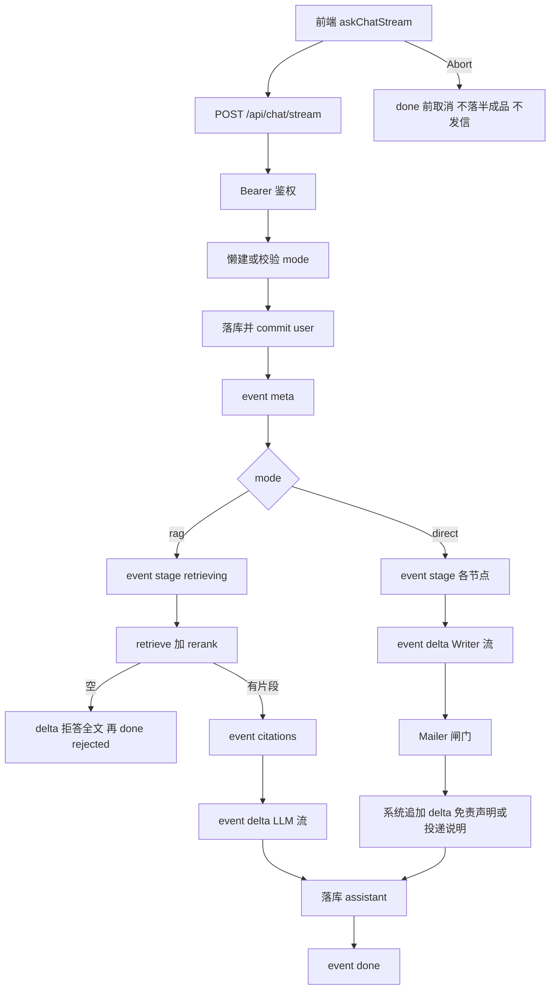

# Knowledge Hub — 对话 SSE 流式输出技术方案设计文档

- **日期**：2026-10-15
- **状态**：已实现
- **作者**：项目组
- **功能短名**：`chat-sse`
- **对应主文档**：[knowledge-qa-design.md](./knowledge-qa-design.md)
- **外壳文档**：[chat-dual-mode-design.md](./chat-dual-mode-design.md)（`mode` / 路由 / 混聊校验）
- **投研文档**：[stock-research-agent-design.md](./stock-research-agent-design.md)（`mode=direct` 内核）
- **说明**：为知识库问答（`rag`）与投研助手（`direct`）增加 SSE 流式输出；不改检索算法、投研拓扑与业务规则。同步 `POST /api/chat` 保留。

---

## 1. 定位与目标

现网问答为**单次 HTTP 整包返回**：前端 Axios 等待最长约 120s，期间无增量反馈。RAG 在检索/精排后仍有 LLM 生成等待；投研在拉行情/资讯后还有 Writer 长文生成，体感像「卡住」。

本功能在**不改动 RAG 检索链路本体、不改动投研固定拓扑与闸门语义**的前提下，增加传输与 UX 层的 SSE：边生成边推送，投研额外推送阶段进度。

**目标能力**：

- 新增 `POST /api/chat/stream`；请求体与现网 `ChatRequest` 一致（`message` / `conversationId` / `mode`）
- 保留 `POST /api/chat` 同步整包语义（脚本、回归、兼容）
- 统一 SSE 事件：`meta` / `stage` / `citations`（仅 rag 有片段） / `delta` / `done` / `error`
- `rag`：检索阶段推 `stage`；生成前发 `citations` 事件；LLM 逐 token `delta`
- `direct`：各 Agent 节点推 `stage`；Writer 阶段 `delta` 打字流；Mailer 结束后 `done`
- 前端问答全面切流式；输入区支持**停止**（Abort）
- 取消：不落库半成品 assistant；投研取消**一律不发信**；已落库 user 保留

**交付目标**：本地可演示双模式流式；停止可打断；同步接口行为不变；失败/超时文案与现网一致。

---

## 2. 范围与非目标

### 2.1 范围内

| 层 | 内容 |
|----|------|
| API | `POST /api/chat/stream`（SSE）；`POST /api/chat` 行为不变 |
| LLM | `chat_completion_stream`（SiliconFlow / OpenAI 兼容 `stream: true`） |
| 服务 | `ask_stream`：按 `mode` 分支 yield 事件；落库时机见 §6 |
| 投研 | 图执行可推 `stage`；Writer 接 stream；取消跳过 Mailer |
| 前端 | `askChatStream`（fetch + Bearer）；Store 增量气泡；停止按钮；`stage` 文案 |
| 运维 | 网关/Vite 缓冲关闭、读超时、SSE 心跳保活 |
| 文档 | 实现阶段回写双模式/投研规格中「非目标含 SSE」表述（见 §11） |

### 2.2 非目标（本规格不做）

- WebSocket / 双向实时通道
- 改变同步 `POST /api/chat` 的响应形态或业务语义
- 第三种 `mode`；改检索 / Rerank / 拒答门槛；改投研拓扑或发信闸门规则（仅增加推送与 Writer 流式）
- 流式入库（文档上传仍同步长请求）
- 强杀卡住的上游 HTTP（与投研规格一致：超时不发信 + 尽快结束流）
- 独立模型/计费档、限流队列、按钮级权限拆分
- 原生 `EventSource`（GET-only 且难带 Bearer；本规格用 `fetch`）

---

## 3. 数据流

**要点**：

- 建流前失败（未登录、混聊、空消息等）仍走常规 HTTP + `AppError`，不进入 SSE。
- 流式响应**不**使用整包 `{"code":0,"data":...}` 信封；终态在 `done` / `error` 事件中携带业务字段。
- `rag` 检索/精排逻辑与现网一致；仅传输层改为事件推送。
- `direct` 业务规则（超时文案、不发半成品研报、Mailer 闸门）以投研规格为准；本规格只规定如何推送与执行模型（§5.1）。

---

## 4. SSE 事件协议

### 4.1 传输

| 项 | 约定 |
|----|------|
| 方法 / 路径 | `POST /api/chat/stream` |
| 请求体 | 与 `ChatRequest` 相同：`message`、`conversationId?`、`mode?`（缺省/`null` → `rag`） |
| 鉴权 | `Authorization: Bearer <token>`（与现网一致） |
| 响应头 | `Content-Type: text/event-stream`；建议 `Cache-Control: no-cache`；禁用代理缓冲 |
| 帧格式 | 标准 SSE：`event: <name>\ndata: <json>\n\n` |

### 4.2 事件一览

| event | 时机 | data 主要字段 |
|-------|------|----------------|
| `meta` | 落库 user 后立刻 | `conversationId`、`mode` |
| `stage` | 阶段切换 | `stage`、`message`（给人看的短文案） |
| `citations` | rag 有片段、首条 LLM `delta` 之前 | `{ "citations": [ ... ] }`（结构与现网一致） |
| `delta` | 正文增量 | `text`（片段，可拼接） |
| `done` | 本轮已落库 assistant（含成功 / 拒答 / 超时 / 与现网一致的失败说明） | 见 §4.4 |
| `error` | 流已开始且**未**落库 assistant 的不可恢复失败 | `code`、`message`（如 `50010`） |

同一连接上事件顺序：

`meta` → 零或多条 `stage` / `citations` / `delta` → **恰好一条**终态（`done` **或** `error`）→ 关闭流。

取消见 §7.1：可不发终态事件。心跳见 §4.6（SSE comment，不算业务事件）。

### 4.3 `stage` 枚举

**`mode=rag`**

| stage | 含义 |
|-------|------|
| `retrieving` | 向量/BM25/RRF + Rerank 进行中 |

**`mode=direct`**

| stage | 含义 |
|-------|------|
| `coordinator` | 意图解析 / 标的校验 |
| `quote` | 行情 Analyst |
| `market` | 走势 Analyst |
| `news` | 资讯 Analyst |
| `finance` | 财务 Analyst（AKShare；文案「正在整理财务要点…」） |
| `writer` | 报告撰写（随后应有 `delta`） |
| `mailer` | 发信闸门与 SMTP（若触发） |

并行 Analyst 完成时可分别推送对应 `stage`（顺序不保证严格）。无标的 / 超时硬编码分支：仍推 `writer`（便于 UI 统一），再一次或少量 `delta` 推出固定文案。跳过发信时仍推 `mailer`，`message` 标明已跳过（与文末投递说明一致）。进入 Writer 前必须已能区分「有标的 / 无标的 / 已超时」等与现网一致的分支。

### 4.4 `done` 载荷

对齐现网 `POST /api/chat` 的 `data` 字段，并补充流式需要的完整正文：

| 字段 | rag | direct |
|------|-----|--------|
| `conversationId` | 有 | 有 |
| `messageId` | assistant 行 id | 同左 |
| `answer` | 完整最终文本（前端须用其覆盖本地拼接以纠偏） | `report_md` 全文（含系统追加的免责声明/投递说明） |
| `rejected` | 布尔 | 恒 `false` |
| `citations` | 引用数组（拒答时 `[]`） | 恒 `[]` |
| `timedOut` | 可省略 | 布尔 |
| `deliveryStatus` | 可省略 | 字符串（可空） |

**RAG 引用与拒答（已拍板）**：

1. 有片段：在首条 LLM `delta` **之前**发且仅发一次 `event: citations`；`done.citations` 仍带完整数组。
2. 拒答：不发 `citations` 事件；一条 `delta` 推拒答全文（`REJECT_REPLY`）→ `done(rejected=true, citations=[])`。
3. 禁止等全部打完才首次出现引用区。

**direct 系统追加段（已拍板）**：Writer 只流模型正文；免责声明、Mailer 文末投递说明等**系统追加**内容，在 Mailer 步骤结束后用**一次或少量** `delta` 推出，再 `done`。前端仍以 `done.answer` 为权威全文。

### 4.5 `error` 与建流前错误

| 场景 | 行为 |
|------|------|
| 未登录 / 混聊 / 参数非法 | HTTP 4xx + 现有 JSON 错误体（`AppError`），不进入 SSE |
| 流已开始、**未**落库 assistant（如检索阶段失败、取消） | 取消见 §7.1；其它失败发 `error`（`code`/`message` 对齐现网，如 `50010`） |
| 流已开始、与现网一致**已**落库失败说明 assistant（如 LLM 生成失败） | 发 `done`（`answer`=失败文案，含 `messageId`），**不再**发 `error` |
| 投研超时 | 推超时文案（`delta`）后 `done`（`timedOut=true`），**不**走 `error`；不发信 |

前端：收到 `done` 则按成功收口（含拒答/超时/失败说明）；仅收到 `error`（无 `done`）时展示失败气泡且历史中无本轮 assistant。

### 4.6 心跳（保活）

检索、并行 Analyst 等阶段可能数十秒无业务事件。实现须定期发送 SSE **comment** 保活（例如每 15s：`: ping\n\n`），防止代理因空闲断连。心跳不是业务事件，前端可忽略。

---

## 5. 后端模块拆分

不平行另起目录；在现有 chat / llm / agent 上扩展。

| 模块 | 职责 |
|------|------|
| [`backend/app/llm/client.py`](../../backend/app/llm/client.py) | 新增 `chat_completion_stream(messages) -> Iterator[str]`；既有 `chat_completion` 保持非流式 |
| [`backend/app/services/qa.py`](../../backend/app/services/qa.py) | **必做**流式生成入口：prompt 拼装与 `generate_answer` **同源**（抽公共拼装，禁止两套 prompt 漂移）；底层调 `chat_completion_stream` |
| [`backend/app/services/chat.py`](../../backend/app/services/chat.py) | `ask_stream`：复用 mode 规范化、会话校验、user 落库、`build_citations` / 拒答常量；按 mode yield 事件；按 §6 落库 |
| [`backend/app/api/chat.py`](../../backend/app/api/chat.py) | `POST /api/chat/stream` → `StreamingResponse`；DB session 在生成器生命周期内持有；感知客户端断开（与 Abort 同等取消） |
| [`backend/app/agent/graph.py`](../../backend/app/agent/graph.py) 等 | 流式执行路径见 §5.1；Writer 接 LLM stream |
| [`backend/app/agent/agents/writer.py`](../../backend/app/agent/agents/writer.py) | 有标的且未超时：流式写出；超时/无标的硬编码分支一次 `delta` |

同步路径 `ask` / `POST /api/chat`：**禁止**借机改业务语义；与 stream **必须**共享：「建会话 + 写 user」、citations 构建、拒答常量、失败文案，避免双路径漂移。日志仍遵守现网约定：不打 Token、不打长正文。

### 5.1 投研流式执行模型（已拍板）

现网同步路径的 `graph.invoke` + `fut.result(timeout=…)` **整图阻塞**，无法边跑边推事件。stream 路径**不得**照搬该阻塞模式作为唯一驱动。

业务闸门语义与投研规格对齐，执行方式调整为：

1. **图内 `deadline_ts` / `timed_out` 继续作为主闸门**（超时后 Writer 硬编码文案、Mailer 不发信）。
2. **增量产出**：用 LangGraph `stream` / 节点回调 / 线程内事件队列等，把 `stage` 与 Writer `delta` 推到 SSE 生成器；禁止「整图结束后再一次性假流式」。
3. **外层兜底**：stream 路径用「截止时间检查 + 停止继续 yield」替代「单次 `fut.result(timeout=)` 堵死整个生成器」。超时仍返回与现网一致的超时文案，`done.timedOut=true`，不发信。
4. **同步 `run_research_graph` / `POST /api/chat`**：可保留现有线程池兜底，行为不变；与 stream 路径共享节点业务逻辑，不共享「必须整图 invoke 完才返回」的传输假设。
5. 不保证强杀卡住的上游 HTTP（与投研规格一致）。

---

## 6. 落库时机

| 步骤 | 行为 |
|------|------|
| 1 | 校验 message / mode；懒建或加载会话；混聊则失败（建流前） |
| 2 | 写入 user 消息并 **commit** |
| 3 | 推送 `meta`（含 `conversationId`） |
| 4 | 执行 rag / direct 流式逻辑（含心跳 comment） |
| 5a 成功 / 拒答 / 投研超时 | 写入完整 assistant 并 commit → `done`（含 `messageId`） |
| 5b LLM 等失败且对齐现网需落库失败说明 | 写失败说明 assistant 并 commit → `done`（`answer`=失败文案）；**不**再发 `error` |
| 5c 检索等失败且无 assistant 可落 | 发 `error`；不写 assistant |
| 5d 客户端取消或连接断开 | **不**写半成品 assistant；不发信；user 已 commit **保留**（孤立 user 为预期）；可不发终态事件 |

取消与失败的区分：取消是客户端 Abort 或连接断开；失败是服务端/上游错误。

---

## 7. 取消、超时与失败

### 7.1 取消（已拍板）

- 前端 `AbortController` 中止 `fetch`；输入区提供「停止」按钮（发送中可见）。
- **在收到 `done` 之前**任何时刻取消（含：仅流出部分 `delta`、或 Writer 已流完正文正在 `mailer`）：  
  - 服务端停止继续 yield；投研**跳过 Mailer**（取消一律不发信）；  
  - **不落库** assistant（即使客户端曾显示过接近完整的报告）；  
  - UI **收回**本轮 assistant 气泡；  
  - 已 commit 的 user **保留**（会话中可出现「有问无答」，属预期，不是缺陷）。
- 网络断线与点「停止」同等按取消处理；刷新后以服务端历史为准。
- 不保证强杀已在跑的 SiliconFlow / 腾讯 HTTP，只保证不再推送、不发信、不落半成品。

> 默认取「规则最简单」：`done` 前取消 = 不落库 + UI 收回。若产品后续要「停止只取消邮件、报告仍落库」，另开修订，不与本规格混用。

### 7.2 超时

- 投研仍遵守 `RESEARCH_GRAPH_TIMEOUT_SEC`（默认 90）及图内 deadline；stream 外层兜底见 §5.1（不得用整图阻塞 `result(timeout=)` 替代增量推送）。
- 超时文案与现网一致；`done.timedOut=true`；**不发信**。
- 前端流式等待建议 ≥ 120s；代理见 §8.2。

### 7.3 失败文案

与现网一致，例如：

- RAG/投研 LLM 失败：「生成答案失败，请稍后重试。」（落库失败说明 + `done`，见 §4.5 / §6）
- 投研超时：投研规格硬编码文案
- 拒答：`REJECT_REPLY`（「依据不足，无法基于知识库回答该问题。」）

---

## 8. 配置、依赖与网关

### 8.1 配置与计费

- 继续使用现有 `LLM_API_KEY` / `LLM_BASE_URL` / `LLM_MODEL`（默认 SiliconFlow + DeepSeek-V4-Flash）。
- 上游 `stream: true` 按 token 计费，**无**单独 SSE 套餐要求；不新增计费相关配置键。
- Embedding / Rerank 配置不变；不对其做「打字流」。

### 8.2 网关与代理

若经 Nginx 等反向代理：

- `proxy_buffering off`（或等价）；响应头建议加 `X-Accel-Buffering: no`
- `proxy_read_timeout` / `proxy_send_timeout` ≥ 问答等待（建议 ≥ 120s；入库仍按主规格更长超时，与本功能无关）

本地 Vite → FastAPI：`vite.config.js` 对 **`/api/chat/stream` 单独代理**（写在通用 `/api` 之前；`timeout`/`proxyTimeout` 拉长；`Cache-Control` / `X-Accel-Buffering`），禁止把 SSE 缓冲成整包。

### 8.3 依赖

- 后端：现有 `fastapi`、`langchain-openai`、`langgraph` 即可支撑 StreamingResponse 与 LLM stream；不强制新框架。
- 前端：用浏览器 `fetch` + `ReadableStream` 解析 SSE；**不**依赖 Axios 扛长流，也**不**用原生 `EventSource`。

---

## 9. 前端改动落点

| 文件 | 改动 |
|------|------|
| [`frontend/src/api/chat.js`](../../frontend/src/api/chat.js) | 新增 `askChatStream(payload, handlers)`；保留 `askChat` 供脚本/兼容 |
| [`frontend/src/stores/createChatStore.js`](../../frontend/src/stores/createChatStore.js) | `ask` 改走 stream：乐观插入 user → 插入空 assistant → 累加 `delta`；持有 `AbortController`；`stopAsking`；`asking` 期间禁止第二条 stream |
| [`frontend/src/components/chat/ChatInput.vue`](../../frontend/src/components/chat/ChatInput.vue) | 发送中展示「停止」；emit 停止事件 |
| ChatWorkspace / 各 Chat View | 展示当前 `stage` 短文案（投研尤其需要）；Markdown 随增量更新（注意性能，可节流） |

**交互约定**：

- 两套 Store（rag / direct）均切 stream，禁止 UI 主路径再调同步 `askChat`。
- 收到 `citations` 后立即渲染引用区；`done` 到达后用服务端 `answer` 覆盖本地拼接（纠偏），写入 `citations` / `rejected` / `conversationId` / `messageId`。
- 取消或断线：收回本轮 assistant 气泡；刷新后可见孤立 user（预期）。
- 鉴权：从 `localStorage` 取 Token 写入 `Authorization`（与 [`http.js`](../../frontend/src/api/http.js) 一致）；建流前 HTTP 错误体解析与现网 Axios 拦截语义对齐（如 `40101` 清 Token）。

---

## 10. 验收清单

| 编号 | 场景 | 期望 |
|------|------|------|
| A1 | rag 有依据提问 | 打字前已有引用区（`citations` 事件）；结束后 `done.citations` / `messageId` 正确 |
| A2 | rag 依据不足 | 无 `citations` 事件；`delta`+`done(rejected=true, citations=[])`；文案与现网一致 |
| A3 | direct 有标的 | 可见多个 `stage`（含跳过发信时的 `mailer`）；Writer 打字流；系统追加段以 `delta` 出现；`done.answer` 含免责声明 |
| A4 | direct 超时 | 超时文案；`timedOut`；**不发信** |
| A5 | 发送中点停止（含 mailer 阶段） | 停止推送；**无** assistant 落库；UI 收回气泡；direct **不发信**；user 保留（孤立 user 预期） |
| A5b | 流中断线后刷新 | 无半成品 assistant；与 A5 一致 |
| A6 | 同步 `POST /api/chat` | 行为与改造前一致（脚本可回归） |
| A7 | 未登录调 stream | 建流前 401 类错误，与现网鉴权一致 |
| A8 | 混聊 mode | 建流前 `40001`，不写脏消息 |
| A9 | LLM 失败 | 落库失败说明 assistant；`done` 带该文案（不发 `error`）；日志可定位 |

---

## 11. 与相关规格的关系

- RAG 检索、Rerank、拒答、入库、RBAC 仍以 [knowledge-qa-design.md](./knowledge-qa-design.md) 为准（已注明 UI 主路径 SSE）。
- 会话 `mode`、双路由、禁止混聊以 [chat-dual-mode-design.md](./chat-dual-mode-design.md) 为准；§2.2 已指向本文。
- 投研拓扑、超时、发信闸门以 [stock-research-agent-design.md](./stock-research-agent-design.md) 为准；传输层 SSE 见本文，业务闸门不变（已回写）。
- 投研 PDF：`report_pdf` 使用 `nl2br`，与前端 `marked` `breaks: true` 对齐。

---

## 12. 实现顺序（建议）

1. `chat_completion_stream` + qa 同源流式拼装 + 最小 `POST /api/chat/stream`（含心跳）
2. `ask_stream` rag：`stage` + `citations` + 拒答路径 + §6 落库/`done`/`error` 分工
3. 投研 §5.1 增量执行：`stage` + Writer stream + 系统追加 `delta` + 取消跳过 Mailer
4. 前端 fetch 解析、Store（禁双飞）、停止按钮、stage 文案、`done` 纠偏
5. §10 验收；回写双模式/投研/主规格相关句子

每个 Phase 的文件级 Task、命令与 Expected 另写实现计划，不在本规格展开。

---

## 13. 批准清单

- [x] 目标与非目标无争议（流式为传输/UX 层，不改检索与投研业务闸门）
- [x] 双接口：保留同步 `/api/chat`，新增 `/api/chat/stream`
- [x] 事件协议：`meta` / `stage` / `citations`(rag) / `delta` / `done` / `error` + comment 心跳
- [x] 终态分工：已落库 assistant → 只 `done`；未落库失败 → `error`；取消可不发终态
- [x] 投研 §5.1：增量推送 + deadline 闸门；禁止整图阻塞假流式
- [x] 投研：`stage` + Writer `delta` + 系统追加 `delta`；`done` 前取消不发信、不落库、UI 收回
- [x] RAG：`citations` 事件在打字前；拒答无该事件；失败文案与现网一致
- [x] 前端主路径切 stream；Bearer + fetch；停止按钮；禁止并行第二条 stream
- [x] 网关/Vite 缓冲与超时、心跳保活已写明
- [x] 验收清单可演示（含 A5/A5b/A6/A9）
- [x] 旧规格「非目标含 SSE」已回写（§11）

**批准人：** 项目组（对话确认 2026-10-15；审查修订同日）  
**批准日期：** 2026-10-15
