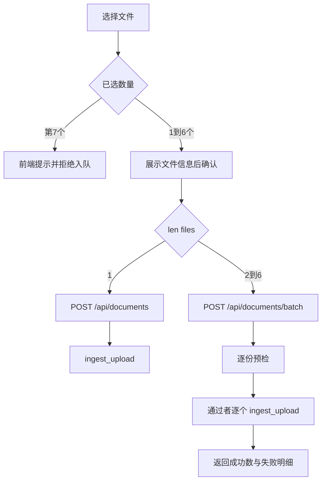
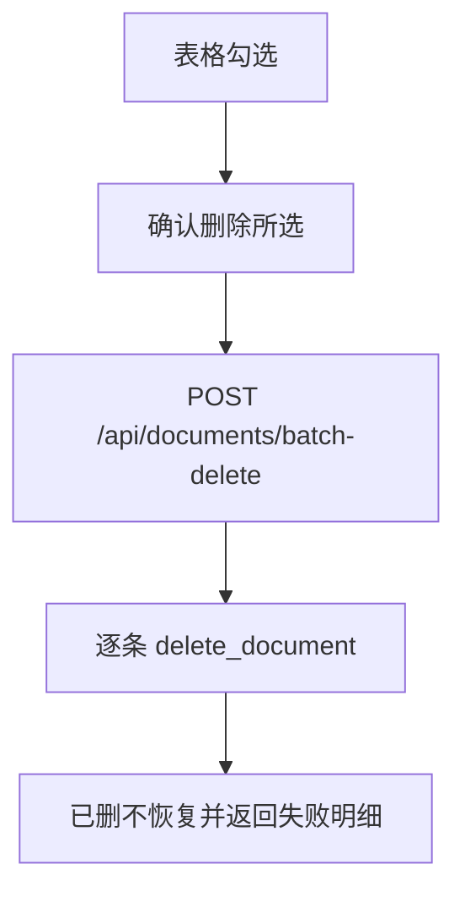

# Knowledge Hub — 文档批量导入与批量删除技术方案设计文档

- **日期**：2026-10-18
- **状态**：已确认，待实现
- **作者**：项目组
- **功能短名**：`document-batch`
- **对应主文档**：[knowledge-qa-design.md](./knowledge-qa-design.md)
- **说明**：在现有同步入库与物理删除上增加批量导入、勾选批量删除。单文件仍走原接口与原交互；批量逐份调用现有 `ingest_upload` / `delete_document`，部分成功、不回滚。

---

## 1. 定位与目标

文档库现网是单文件上传（`POST /api/documents` → `ingest_upload`）和单行删除（`DELETE /api/documents/{id}` → `delete_document`）。列表另有单篇与全部重新解析，与本次导入、删除无关。

本功能让用户一次选择多个文件入库，并在列表勾选后一次删除多篇。解析、切分、Embedding、Chroma、BM25、落盘与回滚仍由现有函数完成，批量层只做分流、预检、逐条执行和汇总。

**目标能力**：

- 上传弹窗改为可多选；选中后仍先展示文件信息，再点「开始入库」
- 恰好 1 个文件时，前端直接调用现有单文件上传，不进入批量接口
- 2～6 个文件走 `POST /api/documents/batch`：先预检，再逐份完整 `ingest_upload`
- 前端在选择第 7 个文件时提示并拒绝入队；后端对批量接口做同样的个数校验
- 单文件大小继续使用 `Settings.INGEST_MAX_MB`（默认 50MB），不另设阈值
- 部分成功：已入库或已删除的不回滚；响应能定位到具体文件及原因
- 列表增加勾选与「删除所选」；逐条 `delete_document` 后汇总

**交付目标**：本地可演示单文件行为与现网一致；一批内同名、超大、解析失败可分别看到；勾选删除失败项可定位；不改检索与重新解析语义。

---

## 2. 范围与非目标

### 2.1 范围内

| 层 | 内容 |
|----|------|
| API | `POST /api/documents/batch`；`POST /api/documents/batch-delete`；原上传与单条删除保持不变 |
| 服务 | 批量预检 + 循环调用 `ingest_upload` / `delete_document`；汇总 `total` / `ok` / `failed` / `items` / `errors` |
| 前端 | 上传弹窗多选与 6 个上限；N=1 走原 `uploadDocument`；表格勾选与「删除所选」 |
| 错误 | 整单参数错误仍用现有 `ErrorCode`；批内失败用 `reason` 字符串，不新增业务错误码 |

### 2.2 非目标（本规格不做）

- 增量索引、内容去重、同名覆盖或合并
- 「删除全部」按钮，以及删除条数上限
- 把单文件请求退化进批量接口再当 N=1 处理
- 流式入库、异步任务、进度推送
- 改解析、切分、Embedding、Rerank、重新解析（`reingest`）规则
- 按钮级权限；仍只验已登录且 `status=1`

---

## 3. 数据流





**要点**：

- 单文件失败仍是整单 HTTP 错误（`AppError`），与现网一致。
- 批量导入与批量删除在参数合法时 HTTP 200，业务结果在 `data` 汇总里；某一份失败不中断其余份。
- 批量导入每份成功路径与单文件相同：解析切分 → Embedding → MySQL → 落盘 → Chroma → BM25。不调用 `reingest_document`。

---

## 4. 后端行为

不新开目录。路由写在 [`backend/app/api/documents.py`](../../backend/app/api/documents.py)，业务写在 [`backend/app/services/ingest.py`](../../backend/app/services/ingest.py)。`POST /api/documents/batch` 与 `POST /api/documents/batch-delete` 必须注册在 `/{document_id}` 之前。

### 4.1 单文件

`POST /api/documents` 与 `ingest_upload` 的校验、错误码、回滚保持现状。前端在 `len(files) == 1` 时只调用这一条。

`POST /api/documents/batch` 收到 0 个、1 个或超过 6 个文件时，整单 `AppError(ErrorCode.BAD_REQUEST, ..., http_status=400)`，不进入逐份处理。只传 1 个文件不得在服务端改调 `ingest_upload` 后包成汇总。

### 4.2 批量导入预检

按请求中的文件顺序逐份判断。未通过的文件不调用 `ingest_upload`，`phase=precheck`。

| 条件 | reason | 说明 |
|------|--------|------|
| 文件名为空、`.`、`..`，或只取 basename 后非法 | `other` | 与现网「非法文件名」一致 |
| 扩展名不在 `pdf` / `docx` / `md` / `txt` | `other` | 对应现网 `42201`，批内不升成整单错误 |
| `len(data) == 0` | `other` | 空文件不进入解析 |
| `len(data) > INGEST_MAX_MB * 1024 * 1024` | `too_large` | 只读现有配置 |
| `filename` 与库内某行在唯一索引 collation 下相等 | `duplicate` | 库内同名 |
| 同一批内已有一份通过预检，且在同一 collation 下相等 | `duplicate` | 只放行队列中的第一份 |

同一文件命中多条时，按上表自上而下取第一条。文件名先取 `Path(filename).name`，不做内容哈希。

同名比较是实现约束，不是待核实项：预检必须与 `document.filename` 唯一索引的 collation 一致。库内是否已存在，用 SQLAlchemy 的 `Document.filename == 参数`（生成带该列 collation 的 SQL 等值比较）。同一批内的互比使用该列的实际 collation（CI 规则下 `A.pdf` 与 `a.pdf` 视为同名；`_bin` / `_as_cs` 等区分大小写的规则下视为不同文件），不得在 Python 里对两个文件名做 `==` 或 `lower()`。不把某一种规则写死。

### 4.3 批量导入处理

预检通过的文件按原顺序调用 `ingest_upload`。不改该函数，也不新增错误码。该函数内部的解析失败、未能提取文本、落库异常仍按现实现回滚该份，不影响已提交的其他份。批量层只根据已经抛出的 `code` 与 `message` 归类：

| 捕获结果 | phase | reason |
|----------|-------|--------|
| `50001` 且消息为「未能提取有效文本」 | `process` | `parse_failed` |
| `50001` 且消息以「入库失败:」开头（Embedding、Chroma、落盘等） | `process` | `other` |
| `40901`（并发同名） | `process` | `duplicate` |
| `41301` | `process` | `too_large` |
| 其他 `AppError` 或未预期异常 | `process` | `other` |

`message` 一律保留异常原文。日志一条 `event=ingest_uploads`（或同等短名），字段含 `total`、`ok`、`failed`，不打文件正文。

### 4.4 批量删除

请求体 `{ "ids": [1, 2] }`。`ids` 缺失、为空、含非正整数时整单 `40001`。服务端按首次出现顺序去重。无条数上限。

对每个 id 调用现有 `delete_document`，不改该函数里 Chroma、库、磁盘的顺序，也不为磁盘清理另加状态。调用前先读出 `filename`（没有则为空字符串），便于失败项仍能带上文件名。

- 函数正常返回：计入 `ok`，`items` 记 `documentId` 与 `filename`。此时库行与索引已按该函数现有逻辑删除，磁盘清理也已由该函数做完。
- 抛出文档不存在（40401）：`reason=not_found`，`message` 为「文档不存在」
- 函数抛出的其它错误：`reason=delete_failed`，`message` 为异常原文。与单条删除相同，清 Chroma 失败时该条不动库与文件；函数在 `commit` 之后若删除磁盘文件再抛错，批量层只把这个异常记入 `errors`，不补删、不回滚

已成功删除的文档不恢复。日志 `event=delete_documents`，字段含 `total`、`ok`、`failed`。

---

## 5. API 约定

统一成功信封仍为 `ok()`：`{"code":0,"message":"success","data":{...}}`。整单失败仍走现有 `AppError`，不把「超过 6 个」放进 `errors`。

### 5.1 `POST /api/documents/batch`

- `multipart/form-data`，字段名 `files`，2～6 个文件
- 超时与单文件上传相同，前端 600000ms
- 鉴权与现网文档接口相同

`data`：

```json
{
  "total": 3,
  "ok": 1,
  "failed": 2,
  "items": [{ "index": 0 }],
  "errors": [
    {
      "index": 1,
      "filename": "a.pdf",
      "phase": "precheck",
      "reason": "duplicate",
      "message": "同名文档已存在"
    },
    {
      "index": 2,
      "filename": "b.pdf",
      "phase": "process",
      "reason": "parse_failed",
      "message": "未能提取有效文本"
    }
  ]
}
```

`index` 从 0 开始，对应该次 `files` 的提交顺序。每个下标只出现一次，要么在 `items`，要么在 `errors`。`items` 在现有 `_doc_to_dict` 上增加 `index`，其余字段与 `GET /api/documents` 的元素同形。没有全局 camelCase 转换。`total = ok + failed`，`total` 为本次提交的文件数（含预检失败）。

前端 `FormData` 的文件顺序必须与弹窗列表一致，服务端按该顺序编号。删除接口不使用 `index`，用文档 `id` 对应。

导入 `errors[].reason` 仅允许：`duplicate`、`too_large`、`parse_failed`、`other`。删除接口的 `reason` 见 §5.2，不使用这四个值。

### 5.2 `POST /api/documents/batch-delete`

```json
{ "ids": [12, 15] }
```

`data.errors` 字段：`documentId`、`filename`、`reason`（`not_found` | `delete_failed`）、`message`。`items` 为已删除项：`documentId`、`filename`。

请求模型放在 `app/schemas/`（新建小模块或并入现有 schema），不在路由函数里堆校验逻辑。

### 5.3 整单错误码（不新增）

| 场景 | code | HTTP |
|------|------|------|
| 批量文件数不是 2～6；删除 `ids` 为空或非法 | 40001 | 400 |
| 单文件上传：同名 | 40901 | 409 |
| 单文件上传：超大 | 41301 | 413 |
| 单文件上传：类型不支持 | 42201 | 422 |
| 单文件上传：解析或入库失败 | 50001 | 500 |
| 单条删除：不存在 | 40401 | 404 |
| 单条删除：Chroma 失败 | 50000 | 500 |

批内对应失败只出现在 `errors[].reason`，整单仍 `code=0`。

---

## 6. 前端交互

改动限于 [`frontend/src/components/ingest/UploadPanel.vue`](../../frontend/src/components/ingest/UploadPanel.vue)、[`frontend/src/views/documents/DocumentListView.vue`](../../frontend/src/views/documents/DocumentListView.vue)、[`frontend/src/api/documents.js`](../../frontend/src/api/documents.js)、[`frontend/src/stores/document.js`](../../frontend/src/stores/document.js)。

### 6.1 上传

- `el-upload` 开启 `multiple`，`limit` 为 6，`auto-upload` 仍为 false
- 超出 6 个：提示「单次最多上传 6 个文件」，该文件不进入列表
- 已选列表展示每个文件名和大小；按钮文案在入库中为「入库中...」
- 确认时：`files.length === 1` 调用现有 `uploadDocument` / store `upload`；成功提示「入库成功」，关闭弹窗并刷新
- `files.length > 1` 调用批量接口。全部成功：成功提示并关闭弹窗。存在失败：警告只写「成功 X 个，失败 Y 个」
- 失败项留在弹窗的已选列表中，按 `errors[].index` 对上本次提交的文件，每条固定展示三行：阶段（`precheck` → 未开始，`process` → 处理中）、原因标签、`message`。原因标签：`duplicate` → 同名，`too_large` → 超大，`parse_failed` → 解析失败，`other` → 其他。`message` 始终显示，不因标签是「解析失败」而省略
- 批量有成功项时刷新文档列表。全部成功则关闭弹窗。存在失败时弹窗保持打开，按 `items[].index` 移除已成功文件，只保留 `errors` 里的下标；不按文件名移除。成功数量只出现在汇总提示里
- 再次点「开始入库」只提交剩余失败项，下标从 0 重新编排。仍是 1 个文件时走单文件接口；仍多于 1 个时走批量接口。已成功项不再次进入预检，避免出现 `precheck` + `duplicate`

### 6.2 删除

- 表格增加选择列；工具栏「删除所选」在未勾选或正在重新解析时禁用
- 确认框写明选中数量，以及将物理删除索引与文件
- 完成后提示「删除成功 X 条，失败 Y 条」；有失败时列出文件名（或 id）与原因
- 不提供「删除全部」

---

## 7. 测试要点

以接口与页面手工验证为主，必要时用仓库根目录脚本风格补一条回归。不测压测。

- 1 个合法文件：请求打到 `POST /api/documents`，列表新增一行，交互与现网一致
- 直接向 `/batch` 提交 1 个或 7 个文件：HTTP 400，`code=40001`，库中无新文档
- 选择第 7 个文件：前端不入队，且未发请求
- 一批内：1 个成功、1 个库内同名、1 个超大、1 个空文本：成功份已可检索；空文本为 `process` + `parse_failed`，`message` 为「未能提取有效文本」；超大阈值等于 `INGEST_MAX_MB`
- 处理阶段模拟 Embedding 或 Chroma 失败：`process` + `other`，`message` 以「入库失败:」开头，弹窗同时显示「其他」和该原文
- 同一批两个相同文件名：第一份入库，第二份 `precheck` + `duplicate`；两者 `index` 不同，弹窗只留下失败的那一份，再次入库不会把已成功文件再送去预检
- 同一批 `A.pdf` 与 `a.pdf`：结果与 `document.filename` 唯一索引 collation 一致（CI 则第二份预检同名；CS/BIN 则两份都可入库）
- 勾选删除：混合存在与不存在的 id；存在的文档索引与磁盘目录删除，不存在的出现在 `errors`，已删的不恢复
- 重新解析单篇与全部重新解析仍可用；删除按钮在重新解析进行中禁用

---

## 8. 待实现时核实项

- Element Plus `el-upload` 的 `on-exceed` 与 `limit` 在「先选 6 个再追加」时是否还能拿到被拒绝的文件；若不能，提交前再数一次 `files.length`
- 代理对 multipart 多文件的 body 大小限制是否仍高于 `6 * INGEST_MAX_MB`

---

## 9. 批准清单

- [x] 单文件走原接口，批量接口拒绝 N=1
- [x] 单次最多 6 个，前端选择阶段拦截，后端兜底
- [x] 单文件大小只用 `INGEST_MAX_MB`
- [x] 预检拦截同名与超大；同名比较与 `document.filename` 唯一索引 collation 一致；解析失败在处理阶段暴露
- [x] 部分成功，不回滚；失败可定位到文件与原因；按 `index` 移出已成功文件，重试只处理剩余失败项
- [x] 只做「删除所选」，已删不恢复
- [x] 不引入增量索引或去重合并

**批准人：** 项目组  
**批准日期：** 2026-10-18
