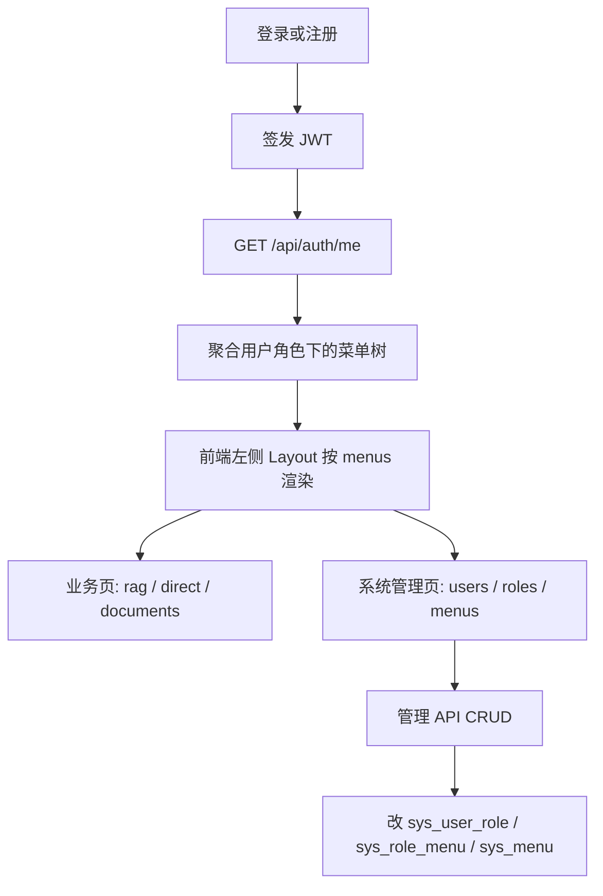

# Knowledge Hub — 用户 / 角色 / 菜单 RBAC 技术方案设计文档

- **日期**：2026-10-15
- **状态**：已实现
- **作者**：项目组
- **功能短名**：`rbac-menu`
- **对应主文档**：[knowledge-qa-design.md](./knowledge-qa-design.md)
- **相关**：[knowledge-qa-phase2-design.md](./phase/knowledge-qa-phase2-design.md)（JWT / `/me`）；[chat-dual-mode-design.md](./chat-dual-mode-design.md)（业务入口路由）
- **说明**：将一期「User–Role–Permission」脚手架改为常见后台的 **User–Role–Menu**；落地系统管理三页与左侧菜单导航；业务入口从顶栏迁入菜单树。

---

## 1. 定位与目标

现网认证已具备 JWT 注册 / 登录与五表 RBAC 种子，但：

- 权限实体是 **`sys_permission`（API 权限码）**，无菜单；
- 业务 API **只验已登录 + status=1**，角色差异未用于 UI；
- 前端为顶栏三入口，无系统管理页。

本功能在**不改动 RAG / 投研业务链路**的前提下，换成菜单型 RBAC，并提供可演示的管理能力。

**目标能力**：

- 五表：`sys_user` / `sys_role` / `sys_menu` / `sys_user_role` / `sys_role_menu`
- 废弃 `sys_permission`、`sys_role_permission`；权限标识落到 `sys_menu.perms`（本版仅存档，不用于接口拦截）
- 管理端：用户管理、角色管理（含勾选菜单）、菜单管理（树 CRUD）
- 壳层：登录后左侧导航按角色菜单渲染；顶栏业务链接移除
- 种子：`admin` 全菜单；`user` 仅业务三项（知识库问答 / 投研助手 / 文档）
- 保留公开注册，默认绑角色 `user`

**交付目标**：本地清库或重建后，种子 `admin` 可进系统管理与全部业务；注册用户仅见业务三入口；用户 / 角色 / 菜单 CRUD 可演示。

---

## 2. 范围与非目标

### 2.1 范围内

| 层 | 内容 |
|----|------|
| 数据 | 新增 `sys_menu`、`sys_role_menu`；删除 Permission 相关表与 ORM；seed 改为菜单树 + role_menu |
| API | 用户 / 角色 / 菜单 CRUD；角色分配菜单；用户分配角色；`GET /api/auth/me` 返回 `roles` + `menus`（去掉 `permissions`） |
| 后端 | `models/rbac.py` 重写；`auth/seed.py`；`api` / `services` / `schemas` 新模块；`main.py` 挂路由 |
| 前端 | 左侧 Layout；路由 `/system/users`、`/system/roles`、`/system/menus`；按 `/me.menus` 显隐侧栏；顶栏去掉业务链接 |
| 安全（应用层） | 禁止禁用 / 删除自己；禁止删除内置 `admin`/`user` 角色；系统管理三菜单不可删；系统管理菜单仅绑给 `admin` |

### 2.2 非目标（本规格不做）

- **接口级按 `perms` 鉴权**（`require_permission`）：业务与管理 API 仍统一 `Depends(get_current_user)`（已登录 + status=1）。侧栏无菜单 ≠ 接口拒绝；二期再加
- **管理 API 按角色 code=`admin` 软门闩**：本版不做；任意已登录用户直调 `/api/users|roles|menus` 不因非 admin 而 403（见验收 A8）
- **「系统中至少保留一名绑 admin 的 status=1 用户」校验**：本版不做；仅禁止操作**当前登录用户自己**（禁用/删除），不拦卸掉最后一个 admin 角色等场景
- 前端按钮级 `v-permission` / 指令级按钮显隐（本版菜单 `type=button` 可不种子）
- Alembic / 正式迁移框架；本版约定开发环境 **清库或手工 DROP 旧表** 后 `create_all` + seed
- 多租户、数据范围（部门）、OAuth、改密强制策略、操作审计日志独立表
- 用户表扩展昵称 / 手机 / 邮箱（保持现有 `username` / `password_hash` / `status` + 审计列）
- 改动 RAG / 投研 / 文档入库语义

---

## 3. 数据流

**要点**：

- 菜单可见性以 **角色 → role_menu → menu** 为准；`/me` 只返回 `visible=1` 且 `status=1` 的目录 / 菜单节点（读时闭包补祖先）。
- `sys_role_menu` 存法为方案 A（只存勾选，见 §4.4）。
- 业务 API（chat / documents）鉴权语义不变：合法 JWT + status=1。
- 系统管理入口是否出现，靠 **是否给角色分配了对应叶子菜单**；`user` 种子不绑系统管理三菜单。

---

## 4. 数据模型

### 4.0 相对现网的变更总览

| 现网 | 本规格 |
|------|--------|
| `sys_user` | **保留**（字段不变） |
| `sys_role` | **保留**（字段不变） |
| `sys_user_role` | **保留** |
| `sys_permission` | **删除** |
| `sys_role_permission` | **删除** |
| — | **新增** `sys_menu` |
| — | **新增** `sys_role_menu` |

与 [knowledge-qa-design.md](./knowledge-qa-design.md) §5.1.1 冲突时，**以本文为准**；实现落地后回写主文档交叉引用。

关联表仍可不建数据库 FK（与现网风格一致：逻辑外键 + 唯一约束）；ORM 可不声明 `relationship()`。

### 4.1 `sys_menu` — 菜单

| 列 | 类型 | 约束 | 说明 |
|----|------|------|------|
| `id` | BIGINT | PK，自增 | 菜单 ID |
| `parent_id` | BIGINT | NOT NULL，DEFAULT `0` | 父菜单 ID；`0` 表示根 |
| `name` | VARCHAR(128) | NOT NULL | 显示名称 |
| `path` | VARCHAR(255) | 可空 | 前端路由 path（如 `/system/users`）；目录可空；路由由前端静态注册 |
| `icon` | VARCHAR(64) | 可空 | 图标名（Element Plus Icons 名或空） |
| `type` | VARCHAR(32) | NOT NULL | `catalog` \| `menu` \| `button` |
| `perms` | VARCHAR(128) | 可空 | 权限标识（如 `system:user:list`）；本版不用于接口拦截 |
| `sort` | INT | NOT NULL，DEFAULT `0` | 同级排序，升序 |
| `visible` | SMALLINT | NOT NULL，DEFAULT `1` | `1`=显示，`0`=隐藏（隐藏仍可直链访问本版不做拦截） |
| `status` | SMALLINT | NOT NULL，DEFAULT `1` | `1`=正常，`0`=禁用 |
| `created_by` / `created_at` / `updated_by` / `updated_at` | 同现网审计 | | |

唯一性：不强制 `path` 全局唯一（允许空）；业务上同级 `name` 由管理端校验即可。

### 4.2 `sys_role_menu` — 角色–菜单

| 列 | 类型 | 约束 | 说明 |
|----|------|------|------|
| `id` | BIGINT | PK | |
| `role_id` | BIGINT | NOT NULL | `sys_role.id` |
| `menu_id` | BIGINT | NOT NULL | `sys_menu.id` |
| 审计列 | | | 同现网 |
| | | UNIQUE `(role_id, menu_id)` | `uq_role_menu` |

### 4.3 保留表（字段不变）

- **`sys_user`**：`id`、`username`、`password_hash`、`status`（`SMALLINT`：`1`=正常 / `0`=禁用）、审计列
- **`sys_role`**：`id`、`code`（如 `admin`/`user`）、`name`、审计列
- **`sys_user_role`**：`user_id`、`role_id`、UNIQUE `(user_id, role_id)`、审计列

### 4.4 种子菜单树

根级两个目录，其下挂菜单（`type=menu`）。`path` 与前端路由一致。

**角色–菜单存储约定（方案 A）**：`sys_role_menu` **只存勾选/种子显式绑定的节点**；**不**在保存时自动写入祖先 catalog。侧栏所需的目录层级由 `/me` **读时授权闭包**补齐（见 §4.5）。管理端角色详情返回的 `menuIds` 与库内一致（通常为叶子）；勾选回显以库为准，父节点半选由前端树组件根据子节点推导。

| 排序 | parent | name | type | path | perms（示例） | 绑 admin | 绑 user |
|------|--------|------|------|------|---------------|----------|---------|
| 10 | 根 | 系统管理 | catalog | — | `system:catalog` | 否（闭包补） | 否 |
| 11 | 系统管理 | 用户管理 | menu | `/system/users` | `system:user:list` | 是 | 否 |
| 12 | 系统管理 | 角色管理 | menu | `/system/roles` | `system:role:list` | 是 | 否 |
| 13 | 系统管理 | 菜单管理 | menu | `/system/menus` | `system:menu:list` | 是 | 否 |
| 20 | 根 | 知识库问答 | menu | `/chat/rag` | `biz:chat:rag` | 是 | 是 |
| 21 | 根 | 投研助手 | menu | `/chat/direct` | `biz:chat:direct` | 是 | 是 |
| 22 | 根 | 文档 | menu | `/documents` | `biz:doc:list` | 是 | 是 |

> 业务三项**根级平铺**，无「业务功能」目录；存量库启动 seed 时会删除 `perms=biz:catalog` 的旧目录，并把三项 `parent_id` 改为 `0`。

说明：

- 「问答」产品语义对应现网 **文档**页 `/documents`（入库与列表），不是会话历史。
- 本版**不强制**种子 `type=button` 节点；`perms` 写入便于二期接口鉴权复用。
- 角色种子仍为 `admin`（管理员）、`user`（普通用户）；默认用户 `admin` / `123456` 绑 `admin` 角色（密码规则同现网：已存在不重置）。
- 注册仍只绑 `user`。
- 种子 `role_menu`：**仅绑上表中「是」的 leaf `menu`**；「系统管理」catalog **不写**关联行（靠闭包补）。
- **内置系统管理菜单不可删除**（见 §5.4）：种子中 path 为 `/system/users`、`/system/roles`、`/system/menus` 的三个 `menu` 节点，以及其父目录「系统管理」（可用 `perms=system:catalog` 或实现时打 `builtin` 标记识别）。允许改名称 / 图标 / 排序 / 显隐，**禁止 DELETE**。业务三项（知识库问答 / 投研助手 / 文档）本规格**不**强制禁删。

### 4.5 `/me` 菜单聚合规则

1. 查用户全部 `role_id` → `sys_role_menu` 全部 `menu_id`（去重）；库内按方案 A 通常只有叶子
2. 过滤 `status=1` 且 `visible=1` 且 `type in (catalog, menu)`（`/me` **不返回** 隐藏 / 禁用 / `button`；管理端全量树走 `GET /api/menus/tree`）
3. **授权闭包**：若某菜单在授权集合中，则沿 `parent_id` 向上把缺失的祖先（多为 catalog）一并纳入，再按 `parent_id` + `sort` 组装树，保证侧栏可渲染分组
4. 语义：只勾选 catalog、未勾任何子菜单时，**不**视为拥有该目录下全部子菜单；闭包只补「已授权节点的祖先」，不向下展开

---

## 5. API 约定

统一响应：`{ "code": 0, "message": "success", "data": ... }`。鉴权：`Bearer` JWT + status=1（与现网一致）。JSON 字段 **camelCase**；`status` / `visible` 为数字 `0|1`。

### 5.1 认证变更

| 方法 | 路径 | 说明 |
|------|------|------|
| POST | `/api/auth/register` | 不变：建用户 + 绑 `user` |
| POST | `/api/auth/login` | 不变 |
| GET | `/api/auth/me` | **变更**：返回 `id`、`username`、`status`、`roles[]`、`menus`（树）；**不再**返回 `permissions` |

`roles[]` 元素建议：`{ "code", "name" }`。  
`menus`：树节点含 `id`、`parentId`、`name`、`path`、`icon`、`type`、`perms`、`sort`、`children[]`。

### 5.2 用户管理 `/api/users`

| 方法 | 路径 | 说明 |
|------|------|------|
| GET | `/api/users` | 分页列表；可选 `username` 模糊、`status` |
| POST | `/api/users` | 管理员建用户：用户名 + 密码 + 可选 `roleIds`；默认 `status=1` |
| GET | `/api/users/{id}` | 详情（含 `roleIds`） |
| PATCH | `/api/users/{id}` | 更新 `status` 和/或 `roleIds`；可选重置密码字段 |
| DELETE | `/api/users/{id}` | 删除用户并清理 `sys_user_role` |

约束：

- 不能禁用或删除**当前登录用户自己**
- 用户名冲突 → `40902`
- 不存在 → `40401`

分页约定与现网列表风格对齐（若尚无统一分页，本模块采用 `page` / `pageSize`，响应 `items` + `total`）。

### 5.3 角色管理 `/api/roles`

| 方法 | 路径 | 说明 |
|------|------|------|
| GET | `/api/roles` | 列表（可不分页，角色量小） |
| POST | `/api/roles` | 创建：`code`、`name`、可选 `menuIds` |
| GET | `/api/roles/{id}` | 详情 + `menuIds`（**库内原样**，不做闭包补祖先） |
| PATCH | `/api/roles/{id}` | 更新 `name` / `menuIds`（`code` 创建后不可改） |
| DELETE | `/api/roles/{id}` | 删除；清理 `sys_user_role`、`sys_role_menu` |

约束：

- **禁止删除** 内置角色 `admin`、`user`
- `menuIds` 按方案 A：**请求里给什么就存什么**，保存时**不**自动写入祖先 catalog；替换策略为先清该角色旧 `role_menu` 再插入新集合
- `code` 冲突 → **`40903`（`ROLE_EXISTS`）**，写入 [`errors.py`](../../backend/app/common/errors.py)；勿复用文档同名的 `40901`

### 5.4 菜单管理 `/api/menus`

| 方法 | 路径 | 说明 |
|------|------|------|
| GET | `/api/menus/tree` | 全量菜单树（管理端勾选 / 编辑用；需登录） |
| POST | `/api/menus` | 新建节点 |
| PATCH | `/api/menus/{id}` | 更新 |
| DELETE | `/api/menus/{id}` | 删除；若有子节点则拒绝（`40001`），先删子；并清理 `sys_role_menu`；**内置系统管理目录及三菜单**（`/system/users`、`/system/roles`、`/system/menus` 及其父「系统管理」）→ `40001`，不可删 |

### 5.5 错误码

| code | 场景 |
|------|------|
| `40001` | 参数非法；删自己；删内置角色；删有子菜单的节点等 |
| `40101` | 未登录 / Token 无效 / 用户禁用 |
| `40401` | 用户 / 角色 / 菜单不存在 |
| `40902` | 用户名已存在 |
| `40903` | 角色 code 已存在（`ROLE_EXISTS`） |

本版**不新增** `403xx`（无接口级权限码拒绝）。

---

## 6. 后端改动落点

不平行另起顶层包；在现有 `auth` / `api` / `services` / `models` 上扩展。

| 文件 / 目录 | 改动 |
|-------------|------|
| [`backend/app/models/rbac.py`](../../backend/app/models/rbac.py) | 移除 `Permission`、`RolePermission`；新增 `Menu`、`RoleMenu`；保留 `Role`、`UserRole` |
| [`backend/app/models/__init__.py`](../../backend/app/models/__init__.py) | 导出同步 |
| [`backend/app/auth/seed.py`](../../backend/app/auth/seed.py) | 种子菜单树 + `role_menu`；去掉 permission 种子 |
| [`backend/app/services/auth.py`](../../backend/app/services/auth.py) | `/me` 聚合 menus 树，去掉 permissions |
| [`backend/app/services/user_admin.py`](../../backend/app/services/user_admin.py) | 用户 CRUD |
| [`backend/app/services/role_admin.py`](../../backend/app/services/role_admin.py) | 角色 CRUD + 绑菜单 |
| [`backend/app/services/menu_admin.py`](../../backend/app/services/menu_admin.py) · [`menu_tree.py`](../../backend/app/services/menu_tree.py) | 菜单树 CRUD / `/me` 闭包 |
| [`backend/app/api/users.py`](../../backend/app/api/users.py)、[`roles.py`](../../backend/app/api/roles.py)、[`menus.py`](../../backend/app/api/menus.py) | 路由薄封装 |
| [`backend/app/main.py`](../../backend/app/main.py) | `include_router` |
| [`backend/app/schemas/`](../../backend/app/schemas/) | 请求/响应模型 |
| [`backend/app/common/errors.py`](../../backend/app/common/errors.py) | 按需补 `40903` 等 |

路由前缀建议：`/api/users`、`/api/roles`、`/api/menus`（与现有 `/api/auth`、`/api/documents` 平级）。

---

## 7. 前端改动落点

### 7.1 布局

| 项 | 约定 |
|----|------|
| 壳层 | [`layouts/AppLayout.vue`](../../frontend/src/layouts/AppLayout.vue)：左侧菜单 + 顶区用户下拉（退出）+ `<RouterView />` |
| [`App.vue`](../../frontend/src/App.vue) | 仅 `<RouterView />` + 登录后补拉 `/me`；Layout 由路由父级挂载 |
| 顶栏业务链接 | **移除**「知识库问答 / 投研助手 / 文档」；改由侧栏 `el-menu` 根据 `menus` 生成 |
| 菜单图标 | [`components/system/IconSelect.vue`](../../frontend/src/components/system/IconSelect.vue) + [`utils/icons.js`](../../frontend/src/utils/icons.js)；`icon` 存 Element Plus Icons 组件名 |
| 系统管理页 | [`views/system/`](../../frontend/src/views/system/)：`UserManageView` / `RoleManageView` / `MenuManageView` |
| 聊天页内部会话侧栏 | [`ChatWorkspace.vue`](../../frontend/src/components/chat/ChatWorkspace.vue) **保留**（会话列表 ≠ 系统菜单） |

侧栏高度与现有 `--topbar-h` 等 token 协调；视觉延续 [`global.css`](../../frontend/src/assets/css/global.css)，不另起设计体系。

### 7.2 路由

| path | 说明 |
|------|------|
| `/system/users` | 用户管理 |
| `/system/roles` | 角色管理 |
| `/system/menus` | 菜单管理 |
| `/chat/rag`、`/chat/direct`、`/documents` | 业务路由保留；默认 `/`、`/chat` → `/chat/rag`（固定落地；本版不做「首个有权限菜单」回退） |

路由表可静态注册全部页面组件；**侧栏是否显示**由 menus 决定。本版不做路由全局 beforeEach 的菜单 path 强校验（与「接口不按 perms 拦截」一致）；若直链打开无权限菜单页，页面仍可能加载——可接受，二期再收紧。

### 7.3 管理页（MVP）

| 页 | 能力 |
|----|------|
| 用户 | 表格列表；新建；启用/禁用；分配角色；重置密码；删除（非自己） |
| 角色 | 列表；新建/编辑名称；树形勾选菜单保存；内置角色不可删 |
| 菜单 | 树表；新建子节点；编辑；删除无子供节点（内置系统管理目录及三管理菜单无删除按钮 / 删除接口拒绝） |

### 7.4 Store / API

- [`stores/user.js`](../../frontend/src/stores/user.js)：`profile` 含 `menus`；登录后 `loadMe` 驱动侧栏
- 新建 `api/users.js`、`api/roles.js`、`api/menus.js`

---

## 8. 兼容与迁移

| 项 | 策略 |
|----|------|
| 开发库已有 `sys_permission` / `sys_role_permission` | **可清库**；或跑 [`scripts/migrate_rbac_menu.py`](../../scripts/migrate_rbac_menu.py) / 手工 `DROP TABLE` 后重启，依赖 lifespan `create_all` + 新 seed |
| `create_all` | **不会**自动删旧表；必须人工 DROP 或整库重建 |
| 前端旧 `/me` 读 `permissions` | 改为读 `menus`；无 permissions 字段 |
| 顶栏入口 | 删除后仅侧栏；书签旧行为依赖侧栏同等 path |
| 回归脚本 | [`scripts/verify_rbac_menu.py`](../../scripts/verify_rbac_menu.py) 冒烟 A1–A8 |

不提供 Alembic；不写生产灰度迁移脚本（本仓库当前阶段以本地演示为主）。

---

## 9. 验收标准

| 编号 | 标准 |
|------|------|
| A1 | 库中无 `sys_permission` / `sys_role_permission`；存在 `sys_menu` / `sys_role_menu` |
| A2 | 种子 `admin`/`123456` 登录后侧栏可见系统管理三页 + 业务三项 |
| A3 | 新注册用户侧栏**仅**业务三项，无系统管理 |
| A4 | admin 可完成用户 CRUD、角色绑菜单、菜单树 CRUD 的基本演示 |
| A5 | 不能禁用/删除当前登录用户；不能删除内置 `admin`/`user` 角色 |
| A5b | 不能删除「系统管理」目录及「用户管理 / 角色管理 / 菜单管理」三个菜单节点 |
| A6 | `GET /api/auth/me` 含 `menus` 树，不含 `permissions` |
| A7 | 业务主链路（rag / direct / 文档）在菜单进入后行为与改前一致 |
| A8 | 业务 API 仍只验登录；无菜单的用户若直调管理 API，本版**不**以 403 拒绝（已知限制） |

---

## 10. 与主规格关系

- JWT、注册绑 `user`、业务 API「只验登录」仍以 [knowledge-qa-design.md](./knowledge-qa-design.md) 与 Phase 2 为准。
- **RBAC 表结构与 `/me` 载荷**以本文为准，替代主文档 §5.1.1 中的 Permission 模型描述；实现后应回写主文档并改指向本文。
- 业务路由 path（`/chat/rag`、`/chat/direct`、`/documents`）与 [chat-dual-mode-design.md](./chat-dual-mode-design.md) 一致；本文只改**导航壳**，不改 mode 语义。
- 二期若做接口级鉴权：复用 `sys_menu.perms` + 依赖注入，不另起 Permission 表。

---

## 11. 分阶段实现建议（实现计划另写）

| 步 | 内容 |
|----|------|
| 1 | 模型 + seed + 清库验证；`/me` 返回 menus |
| 2 | users / roles / menus API |
| 3 | 前端 Layout + 侧栏 + 三管理页 |
| 4 | （非本规格）接口 perms 拦截与前端路由守卫 |

每个 Phase 批准后单独写实现计划（Task / 命令 / Expected），不在本规格写文件级勾选步骤。

---

## 12. 批准清单

- [x] 五表为 user / role / menu / user_role / role_menu；废弃 permission
- [x] 一期仅菜单控侧栏；接口仍只验登录 + status=1
- [x] 种子：admin 全量；user 仅业务三项；「文档」=`/documents`
- [x] 保留公开注册；默认可清库重建
- [x] 禁止删自己、禁止删内置 admin/user 角色
- [x] 内置「系统管理」及用户/角色/菜单管理三菜单不可删除
- [x] 角色菜单存方案 A：只存勾选/叶子；`/me` 读时授权闭包；种子 catalog 不写 `role_menu`
- [x] 「至少一个 admin」校验、管理 API 的 admin 软门闩：本版明确不做（§2.2）
- [x] 目标与非目标无争议（含不做接口 403、不做 Alembic）
- [x] 验收标准可演示

**批准人：** 项目组（按口头确认：`1A 2删 3文档 4user仅业务 5保留注册 6可清库`；系统管理三菜单不可删；角色菜单存 A；「至少一个 admin」与管理 API admin 门闩暂不做）  
**批准日期：** 2026-10-15  
