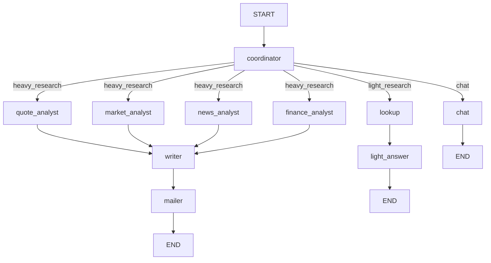
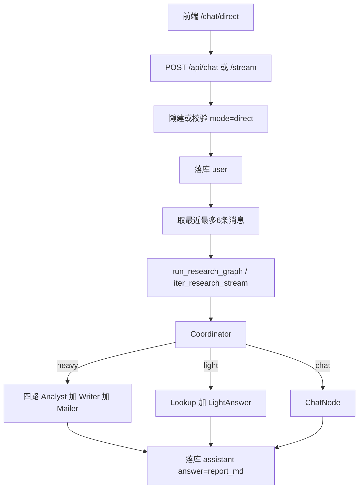

# Knowledge Hub — 投研助手三档路由技术方案设计文档

- **日期**：2026-10-16
- **状态**：已实现
- **作者**：项目组
- **功能短名**：`research-tri-route`
- **对应主文档**：[knowledge-qa-design.md](./knowledge-qa-design.md)
- **前置规格**：[stock-research-agent-design.md](./stock-research-agent-design.md)（`mode=direct` 重投研内核）
- **外壳文档**：[chat-dual-mode-design.md](./chat-dual-mode-design.md)；传输层：[chat-sse-design.md](./chat-sse-design.md)
- **说明**：在 `mode=direct` 内增加 Coordinator **三档分流**（重投研 / 轻投研 / 闲聊）。重投研链路保持现网四路 Analyst → Writer → Mailer；轻问与闲聊**不**拧进 Writer。不改动 RAG，不新增第三种 `mode`。

---

## 1. 定位与目标

现网投研助手对无标的输入统一走 Writer 硬编码「请说明股票名称或代码」，无法自然承接闲聊；若把「茅台怎么样」一律抬成整份研报又过重。本功能在**同一张 LangGraph、同一 `mode=direct`** 内做三档路由。

**拍板总表**：

| 项 | 定 |
|----|-----|
| 三档 | `heavy_research` / `light_research` / `chat` |
| 判定 | Coordinator 出 `route` + 标的 + `continues_previous` |
| 闲聊历史 | 最近 6 条（仅 `chat`） |
| Redis | heavy / light 写 symbol；TTL **2h**，读写续期；chat 不写；降级不 500 |
| 沿用 | 抽不到 + `continues_previous=true` → 沿用上一只 |
| 轻档 | 快照 + 财务，直接答，不拉四路 |
| 发信 | **仅重投研**；轻/闲聊永不走 Mailer |
| 人设 | 统一「投研助手」；可闲聊、可非股票；买卖建议短声明；不装 RAG |
| mode | 不改（仍 `direct`） |

**目标能力**：

- 复用 `POST /api/chat`、`POST /api/chat/stream` + `mode=direct`
- Coordinator 一次判定后三岔；重投研拓扑与发信闸门语义不变
- 轻投研：腾讯快照 + 财务要点 → 短答
- 闲聊：同一投研助手人设 + 最近 6 条历史；不检索、不拉行情
- 会话标的 Redis 槽支持「它现在多少钱」类续指

**交付目标**：可演示下表对话形态；`mode=rag` 不变。

| 用户 | 期望档 | 助手形态（示意） |
|------|--------|------------------|
| 分析贵州茅台近日行情发到 foo@example.com | heavy | 整份研报 + 可发信 |
| 茅台怎么样 | light | 现价/涨跌/财务要点短答 |
| 把茅台现价发到 foo@example.com | light | 答现价 + 提示须走研报流程发信；**不发信** |
| 今天天气怎么样 | chat | 闲聊（说明查不了天气等） |
| 它现在多少钱 / 它呢（上轮谈过茅台） | light | 先续指 Redis，再短答；不因本轮无代码落 chat |
| 对比茅台和五粮液 | heavy | 只分析第一只；正文写明对比分析暂未支持 |
| 分析苹果（代码表无此标的） | chat | 说明主要覆盖 A 股；不编行情 |

---

## 2. 范围与非目标

### 2.1 范围内

| 层 | 内容 |
|----|------|
| 后端 `agent/` | State 扩展；Coordinator 三档；Lookup / LightAnswer / Chat 节点；`research_context` Redis；`graph.py` / `stream.py` 条件边 |
| 对话 | `_ask_direct` / `_ask_direct_stream` 传入 `conversation_id` + 最近 6 条；日志带 `route` |
| 前端 | `/chat/direct` 空态/placeholder 文案（可闲聊、可问现价；示例仍保留研报话术） |
| 文档 | 本文；实现后回写投研 / dual-mode 中「无闲聊、无历史」过时表述 |

### 2.2 非目标

- 第三种 `mode`；改 RAG / Embedding / Rerank
- 开放 Supervisor、Agent 辩论、checkpointer 多轮研报续写
- light 拉日 K / 资讯；light / chat 发邮件
- 另起「闲聊助手」人设或独立入口
- 独立模型档、限流队列、发信权限拆分

---

## 3. 架构与数据流

### 3.1 LangGraph 拓扑



**与现网对照**：

| | 现网 | 本规格 |
|--|------|--------|
| 入口 | `START → coordinator` | 不变 |
| 有标的 | 固定四路 → Writer → Mailer | 仅 `heavy_research` |
| 无标的 | Writer 硬编码拒答 → Mailer 跳过 | 拆为 light / chat 新边 |
| 条件边依据 | `skip_analysts` | 以 `route` 为准（`skip_analysts` 可由 `route != heavy_research` 推导，避免双源真相） |

### 3.2 端到端数据流



要点：

- LightAnswer / ChatNode 产出仍写入 `report_md`，chat 层 `answer` / SSE `done` **协议不变**
- light / chat **跳过 Mailer**
- SSE：新增 stage `lookup` / `light_answer` / `chat`；LLM 段继续 `delta`（见 [chat-sse-design.md](./chat-sse-design.md)）

---

## 4. 后端模块拆分

### 4.1 目录（增量）

```text
backend/app/agent/
├── state.py                 # + route / conversation_id / history_messages
├── graph.py                 # 三档条件边
├── stream.py                # 与同步语义对齐的 stage/delta
├── agents/
│   ├── coordinator.py       # 输出 route + continues_previous；续指读 Redis
│   ├── lookup.py            # 轻投研：quote + finance
│   ├── light_answer.py      # 短答（可提示发信须走研报）
│   ├── chat.py              # 闲聊补全（投研助手人设 + 6 条历史）
│   ├── writer.py            # 仅 heavy；不再承接无标的闲聊
│   └── mailer.py            # 仅 heavy 路径到达
└── tools/
    └── research_context.py  # 会话标的槽 Redis
```

### 4.2 衔接

| 模块 | 变更 |
|------|------|
| [`services/chat.py`](../../backend/app/services/chat.py) | `_ask_direct` / stream：传 `conversation_id`、最近 6 条；日志 `route=` |
| [`agent/graph.py`](../../backend/app/agent/graph.py) | `run_research_graph(user_input, *, conversation_id, history_messages=...)` |
| [`agent/stream.py`](../../backend/app/agent/stream.py) | 同上参数；三档增量执行 |
| API / RAG / mode 外壳 | 不改 |

---

## 5. State、判定与 Redis

### 5.1 ResearchState 增量

| 字段 | 说明 |
|------|------|
| `route` | `heavy_research` \| `light_research` \| `chat` |
| `conversation_id` | 会话 id；写/读 Redis 槽 |
| `history_messages` | `list[{role, content}]`，最多 6 条；**仅 chat 使用** |
| `intent` | 既有字段 + `continues_previous: bool`；标的 / `want_email` / `to_email` 含义不变 |
| `skip_analysts` | 兼容字段：等价于 `route != heavy_research`（实现期以 `route` 驱边） |

`quote_data` / `finance_data`：light 的 Lookup 复用；heavy 仍由各 Analyst 写入。`market_data` / `news`：light **不写**。

### 5.2 Coordinator 判定契约

规则优先 + LLM 兜底，**一次**产出（写入 `intent`，并提升顶层 `route`）：

```json
{
  "route": "heavy_research | light_research | chat",
  "asset_name": "贵州茅台",
  "asset_code": "600519",
  "want_email": false,
  "to_email": null,
  "continues_previous": false
}
```

| 条件 | route |
|------|--------|
| 有标的 + 明确要分析/研报/对比/多指标深度（含「生成研报并发送」） | `heavy_research` |
| 有标的 + 简单问（怎么样/现价/涨跌/PE 等；**含「把现价发到邮箱」仍属轻档**） | `light_research` |
| 无标的且非续指，或纯闲聊 | `chat` |
| 话术像投研，但代码表校验失败（如「分析苹果」），且非续指 | `chat` |

**发信与抬档（拍板）**：

- 单独「发邮件」话术**不抬档**进 heavy
- 轻档若检出发信意图：照常查数短答，文末提示「发送邮件需要走研报流程（例如：分析某某并生成研报发到邮箱）」——**不偷偷走 Mailer**
- `want_email` **仅**对 `heavy_research` 的 Mailer 闸门生效

**多标的对比（拍板）**：

- 「对比茅台和五粮液」判 `heavy_research`
- `symbol` 只取话术里**第一只**有效 A 股（上例为茅台），走现网单标的研报
- 不并行拉两只，不另开对比模板
- Writer 在报告中显式写一句「本次仅分析 {名称}，对比分析暂未支持」（文案层，不改拓扑）

**续指优先于「解析失败落 chat」**：

1. 本轮抽不到有效标的，且 `continues_previous=true` → **先**读 Redis 上一只；读到则按话术再判 heavy/light（默认 light，除非明确要研报/深度分析）。例如「它呢」「它现在多少钱」不得因本轮无代码而直接落 chat  
2. Redis 未配置或未命中 → `chat`（可澄清「你指哪只股票」）；**降级不 500**  
3. **纯解析失败**才落 chat：话术点了名字/代码，但代码表校验失败，且 `continues_previous=false`（如「分析苹果」）。ChatNode 说明主要覆盖 A 股，**不编造行情数字**。不加第四档  

标的解析仍走 [`symbol.py`](../../backend/app/agent/tools/symbol.py) 校验；**不信 LLM 裸代码**（代码必须出现在用户原文里才接受）。

**抬档与发信的否定（拍板）**：

- 否定词：`不要` / `不用` / `无需` / `不必` / `先别`，以及作动词的 `别`
- `特别` / `分别` / `差别` / `别的` 里的「别」**不算**否定
- 关键词前有否定时不抬档：`分析`、`研报`、`研究报告`、`深度分析`、`近日行情`、`走势分析`、`生成报告`、`写报告`、`出报告`、`对比`、`比较`、`深度`
- 「分析得」不是「分析」（如「你分析得对」）
- 「深度分析」仍是重投研；「深度睡眠 / 深度学习 / 深度优先 / 深度思考」不抬档
- 发信同样先看否定：「别发邮件」「先别发」即使句中有邮箱，`want_email=false`，轻档不追加研报流程提示

**续指口径**：

- 算续指：`它` / `它们`、`这只` / `那只`（不含「这只是闲聊」「那只是我随口一说」）、`上一只`、`刚才那`（不含「刚才那边」）、`同上`、`这票` / `那票`
- 不算续指：`其它` / `其他`、`这只是闲聊`、`刚才那边`
- 闲聊不覆盖、不续期 Redis 槽

**代码表匹配**：

- 简称去空格后再对（代码表「五 粮 液」与口语「五粮液」同一只）
- 全称都收；仅「地名或中国 + 唯一简称」才收短名（如「茅台」→ 贵州茅台）
- 短名若是日常词则不收，避免「资讯」「银行」「股份」等误中（「卓创资讯」仍按全称命中）
- 同一位置取更长匹配；多只按原文出现顺序，对比句只分析第一只

### 5.3 Redis 会话上下文

[`tools/research_context.py`](../../backend/app/agent/tools/research_context.py)：

| 项 | 约定 |
|----|------|
| Key | `kh:agent:research_ctx:{conversation_id}` |
| Value | JSON：`{"code":"600519","name":"贵州茅台"}` |
| TTL | **2 小时**；每次成功 **读或写** 后 `EXPIRE` 续期 |
| 写 | 仅 `heavy_research` / `light_research` 成功解析标的后 |
| 不写 | `chat`（避免闲聊污染标的槽） |
| 降级 | 无 `REDIS_URL` / 读写失败 → 当作无上一只；打 WARNING；不抛业务 500 |

与代码表缓存 Redis（[`symbol.py`](../../backend/app/agent/tools/symbol.py)）共用 `REDIS_URL`，key 空间分离。

---

## 6. 三条分支职责

| route | 节点 | LLM | 历史 | 发信 | 输出形态 |
|-------|------|-----|------|------|----------|
| `heavy_research` | 现网四路 → Writer → Mailer | Writer | 否 | 现闸门（见投研规格 §5.3） | 研报 MD + 免责声明 |
| `light_research` | Lookup → LightAnswer | 短答 | 否 | **永不** | 短 Markdown +「仅供参考」；要发信则追加流程提示 |
| `chat` | ChatNode | 投研助手 system | **最近 6 条** | **永不** | 普通对话；买卖建议短声明；不装知识库 |

### 6.1 Lookup（轻投研拉数）

- 数据范围（首版拍板）：**腾讯快照（Quote）+ 财务要点（Finance）**
- 不拉日 K、不拉资讯；不跑四路 barrier
- 入口查 `deadline_ts`；拉数失败写 `errors`，由 LightAnswer 降级说明

### 6.2 LightAnswer

- 依据 `quote_data` / `finance_data` 回答当前问题；**禁止**套用 Writer 研报章节模板
- 文末一句「仅供参考，不构成投资建议」
- 若 `want_email` 或话术含发信：追加「发送邮件需要走研报流程…」提示
- 同步整包 / 流式 `delta` 均可；超时硬编码短文案

### 6.3 ChatNode

- System：**你是投研助手**（与产品入口一致），也可闲聊与非股票问答；不检索知识库、不假装已读企业文档
- 涉及买卖建议：简短声明不构成投资建议
- Prompt：system + `history_messages`（最多 6）+ 本轮 `user_input`
- 历史由 chat 服务在落库 user 后从本会话消息表取出（user/assistant，按 id；实现时对本轮 user 去重即可）

### 6.4 Writer / Mailer

- Writer：仅 heavy；删除或停用「无标的 → `NO_SYMBOL_MSG`」作为闲聊出口（该路径改由 chat / light 承接）
- 多标的：仍只写第一只的研报，正文显式一句「本次仅分析 {名称}，对比分析暂未支持」
- Mailer：仅 heavy 路径图边到达；light/chat 图上不到达

---

## 7. API 与传输

外壳不变：`message`、`conversationId`、`mode=direct`。

| 接口 | 说明 |
|------|------|
| `POST /api/chat` | 同步；`answer` = 各档 `report_md` |
| `POST /api/chat/stream` | UI 主路径；stage + delta；见 SSE 规格 |

| 相对投研现网 | 本规格 |
|--------------|--------|
| 无标的硬编码拒答 | chat / light 分流 |
| 全程无历史 | 仅 chat 带最近 6 条 |
| 一律可进 Mailer 边 | 仅 heavy |

混聊 `40001`、列表按 `mode` 过滤、路由 `/chat/direct` **不变**。`rejected=false`、`citations=[]` **不变**。

---

## 8. 配置、超时与降级

### 8.1 环境变量

沿用投研规格：`REDIS_URL`（可选）、`RESEARCH_GRAPH_TIMEOUT_SEC`、`SMTP_*`、`RESEARCH_DEFAULT_EMAIL`。本规格**不强制**新 env；TTL 2h 可代码常量（如需可配置再加 `RESEARCH_CTX_TTL_SEC`）。

### 8.2 超时

- 图内 `deadline_ts` + 同步路径外层线程池兜底：**仍必须**（见投研规格 §7.3）
- light 拉数受同一 deadline 约束；超时短文案、不发信
- chat 主要为 LLM；复用外层超时兜底即可

### 8.3 降级

| 场景 | 行为 |
|------|------|
| 无 Redis / 读写失败 | 续指失败 → chat 澄清；不 500 |
| light 行情/财务全空 | LightAnswer 说明数据暂不可用 |
| Coordinator 解析失败 | 按 chat 或澄清；不抛 `50010`（与现网 Coordinator 非致命一致） |
| Writer（heavy）LLM 失败 | 仍按投研规格：失败说明落库后抛错 |

---

## 9. 前端

| 项 | 说明 |
|----|------|
| 路由/Store | `/chat/direct`、`mode=direct` 不变 |
| 空态 | 保留研报示例；补充可问现价、可闲聊的提示一句 |
| 传输 | 仍 `askChatStream`；识别新 stage 文案（lookup / light_answer / chat） |
| 协议 | 无新事件类型；Markdown 渲染不变 |

建议 stage 文案：

| stage | 文案 |
|-------|------|
| `coordinator` | 正在理解你的问题… |
| `lookup` | 正在查询行情与财务… |
| `light_answer` | 正在整理回答… |
| `chat` | 正在回复… |
| 其余 heavy 阶段 | 沿用投研现网文案 |

---

## 10. 实现顺序

1. `research_context` Redis 读写 + State 字段 + `run_research_graph` / stream 增参  
2. Coordinator：`route` / `continues_previous` + 续指  
3. Lookup + LightAnswer；graph/stream 接 light 边  
4. ChatNode + chat 服务取 6 条历史；接 chat 边  
5. 收紧 Writer 无标的出口；heavy 回归发信/超时  
6. 前端空态与 stage 文案；§11 验收  

---

## 11. 验收清单

| 编号 | 场景 | 期望 |
|------|------|------|
| A1 | 分析茅台近日行情发到邮箱 | `heavy`；四路 + 可发信（闸门同投研规格） |
| A2 | 「茅台怎么样」「现价多少」「PE 多少」 | `light`；短答有数据依据；非研报章节结构 |
| A3 | 「把茅台现价发到 foo@example.com」 | **仍 light**；答现价 + 流程提示；**不发信** |
| A4 | 「今天天气怎么样」「你是谁」 | `chat`；投研助手人设；可多轮靠 6 条历史 |
| A5 | 上轮 light/heavy 谈过茅台后问「它多少钱」 | `continues_previous` + Redis → light；2h 内续期 |
| A6 | chat 轮次 | **不**覆盖 Redis 标的槽 |
| A7 | 无 Redis / 槽过期后续指 | chat 澄清；不 500 |
| A8 | `mode=rag` | 与改造前一致 |
| A9 | heavy 超时 | 超时文案；不发信（同投研规格） |
| A10 | 「对比茅台和五粮液」 | `heavy`；只分析第一只（茅台）；正文含「本次仅分析贵州茅台，对比分析暂未支持」 |
| A11 | 「分析苹果」（代码表无此标的，非续指） | `chat`；说明主要覆盖 A 股；不编造行情 |
| A12 | Redis 有上一只时问「它呢」 | 先续指再判 light/heavy；**不**因本轮无代码直接落 chat |
| A13 | 「别发邮件」「先别发」且句中有邮箱 | `want_email=false`；轻档不追加研报流程提示；不发信 |
| A14 | 「不要研报」「你分析得对」「深度睡眠」 | 不抬成 heavy |
| A15 | 「特别分析」「差别很大，帮我分析」 | 仍按「分析」抬成 heavy |
| A16 | 「其它呢」「这只是闲聊」「刚才那边」 | 不算续指；槽保持上一只 |
| A17 | 「五粮液」（代码表为「五 粮 液」） | 命中 000858；「看看资讯」不误中卓创资讯 |

---

## 12. 文档回写（实现完成后）

- [stock-research-agent-design.md](./stock-research-agent-design.md)：注明内核由本文扩展三档；废止「无闲聊 / 无标的仅硬编码」为唯一出口  
- [chat-dual-mode-design.md](./chat-dual-mode-design.md)：`direct`「不带历史」改为「仅 chat 档带最近 6 条；heavy/light 仍不带历史拼进研报/轻答 prompt」  
- [knowledge-qa-design.md](./knowledge-qa-design.md)：索引增加本文链接  

---

## 13. 批准清单

- [x] 三档 route 与判定表（含「现价+邮箱不抬档」）
- [x] 闲聊 6 条历史；统一投研助手人设
- [x] Redis TTL 2h + 读写续期；chat 不写；降级不 500
- [x] 发信仅 heavy；light/chat 永不 Mailer
- [x] 轻档数据范围：快照 + 财务
- [x] 不改 mode / 不改 RAG
- [x] 拓扑与验收场景已对齐
- [x] 多标的对比：heavy + 仅第一只；Writer 写明暂不支持对比
- [x] 解析失败落 chat；续指（`continues_previous` + Redis）优先于该降级

**批准人：** 项目组  
**批准日期：** 2026-10-16
