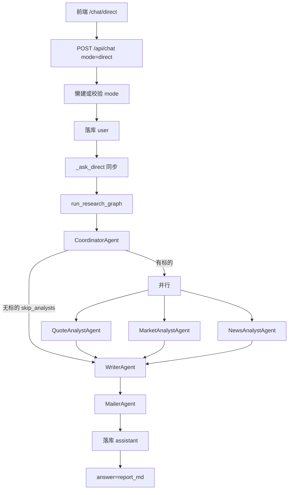

# Knowledge Hub — 股票投研 Multi-Agent 技术方案设计文档

- **日期**：2026-10-14
- **状态**：已实现（待验收）
- **作者**：项目组
- **功能短名**：`stock-research-agent`
- **对应主文档**：[knowledge-qa-design.md](./knowledge-qa-design.md)
- **外壳文档**：[chat-dual-mode-design.md](./chat-dual-mode-design.md)（`mode` / 路由 / 混聊校验）
- **说明**：将 `mode=direct` 闲聊替换为 LangGraph **固定拓扑 Multi-Agent** 投研：Coordinator → 并行 Analyst → Writer → Mailer。不改动 RAG。

---

## 1. 定位与目标

用户一句话下达任务，例如：

> 分析贵州茅台近日行情发到我邮箱

多 Agent 协作产出带免责声明的 Markdown 报告，规则允许时 SMTP 发信，报告落库并展示在聊天页。

**目标能力**：

- 复用 `POST /api/chat` + `mode=direct`（换芯不换壳）
- Multi-Agent **固定拓扑**（不做开放 Supervisor）
- 腾讯行情/资讯直连 + 新浪 A 股代码表；「近日」= **自然日往前 30 天**（报告写明起止日期）
- 发信：话术邮箱优先，否则 `RESEARCH_DEFAULT_EMAIL`（§5.3）
- 每轮独立任务；不带闲聊历史；不调检索 / Embedding / Rerank

**交付目标**：可演示「一句话 → 报告 → 默认邮箱收到邮件」；`mode=rag` 不变。

---

## 2. 范围与非目标

### 2.1 范围内

| 层 | 内容 |
|----|------|
| 后端 | `backend/app/agent/`（state、graph、agents、tools） |
| 对话 | `_ask_direct` → `run_research_graph`；停用闲聊补全 |
| 配置 | `SMTP_*`、`RESEARCH_DEFAULT_EMAIL`、`REDIS_URL`（可选）；`langgraph`、`requests`、`redis`、`markdown` |
| 前端 | `/chat/direct`；空态文案；助手 Markdown 渲染；Axios **120s**；顶栏「投研助手」 |

### 2.2 非目标

- 改 RAG；第三种 mode；保留 `direct` 闲聊
- 开放 Supervisor、Agent 辩论/投票、SSE、短信、续指令、checkpointer
- 独立模型/temperature、发信权限拆分、限流/队列
- 不保证强杀卡住的上游 HTTP；只保证超时**不发信**且 HTTP 尽快返回
- MVP **不**做按 `tasks` 动态裁剪 Analyst（三路固定并行：quote / market / news）
- MVP Analyst **只拉数**，不在 Analyst 内调 LLM（解读留给 Writer）

---

## 3. Multi-Agent 架构与数据流

### 3.1 Agent 角色

| Agent | 职责 | LLM | 工具 |
|-------|------|-----|------|
| **CoordinatorAgent** | 解析意图/`want_email`；代码校验；设 `skip_analysts` | 规则优先 + LLM 兜底 | `symbol` |
| **QuoteAnalystAgent** | 腾讯基础字段 → `quote_data`（核心概览表） | 否 | `tencent` quote |
| **MarketAnalystAgent** | 腾讯日 K → `market_data`（走势） | 否 | `tencent` kline |
| **NewsAnalystAgent** | 腾讯个股资讯 → `news` | 否 | `tencent` news |
| **WriterAgent** | 产出 `report_md`（含硬编码分支） | 仅有标的且未超时 | 无 |
| **MailerAgent** | 发信闸门 + SMTP；文末追加发送状态 | 否 | SMTP |

### 3.2 固定拓扑



- 共享 `ResearchState`；边编译期固定。
- 无标的：Coordinator → Writer 硬编码 → Mailer 跳过 → 唯一落库路径。
- 发信闸门在 **MailerAgent**（§7.3）。

---

## 4. 后端模块拆分

### 4.1 目录

```text
backend/app/agent/          # 勿再建顶层 app/graph/；拓扑即本包内 graph.py
├── __init__.py             # 对外暴露 run_research_graph
├── state.py
├── graph.py                # 固定拓扑编译 + 外层线程池超时
├── logging_util.py         # check_deadline 等
├── agents/
│   ├── coordinator.py
│   ├── quote_analyst.py
│   ├── market_analyst.py
│   ├── news_analyst.py
│   ├── writer.py
│   └── mailer.py
└── tools/
    ├── tencent.py     # 腾讯直连：quote / kline / news
    ├── symbol.py      # 新浪 A 股代码表；可选 Redis 缓存
    ├── email.py       # SMTP；PDF 附件
    └── report_pdf.py  # Markdown → HTML → PyMuPDF Story PDF
```

### 4.2 衔接

| 模块 | 变更 |
|------|------|
| [`chat.py`](../backend/app/services/chat.py) | `_ask_direct` → `run_research_graph` |
| [`qa.py`](../backend/app/services/qa.py) | 废弃 `generate_direct_answer` / `DIRECT_SYSTEM` |
| [`llm/client.py`](../backend/app/llm/client.py) | 供 Coordinator、Writer |
| API / RAG | 不改 |

### 4.3 `_ask_direct` 与 `run_research_graph`

现网同步 `def`；禁止 `asyncio.run(ainvoke(...))`。

```python
def run_research_graph(user_input: str) -> dict:
    """
    返回:
      report_md: str       # 必有；已含发送状态文末；供落库与 answer
      timed_out: bool
      delivery_status: str # 仅日志/调试；chat 层可忽略
    """
```

1. 落库 user 消息。  
2. `result = run_research_graph(question)`（**必须**含 §7.3.2 外层线程池兜底）。  
3. `content = result["report_md"]`；`rejected=false`、`citations=[]`。  
4. Writer 有标的路径 LLM 失败 → 失败说明落库后抛 `50010`。Coordinator 解析失败不当致命错误（§5.2）。  
5. `message.content` 为 **Text**。

---

## 5. State、Agent 与邮件

### 5.1 State

| 字段 | 说明 |
|------|------|
| `user_input` | 原话 |
| `intent` | 标的、`want_email` 等 |
| `skip_analysts` | 仅「无有效标的」；有标的但拉数失败仍为 `false` |
| `deadline_ts` | 截止 Unix 时间 |
| `quote_data` / `market_data` / `news` | 三路 Analyst 各写各字段；失败为空（互不覆盖，无需特殊 reducer） |
| `report_md` | 最终正文（Mailer 会追加文末） |
| `errors` | 非致命错误；**并行 Analyst 可能同时 append**，须用可合并类型（如 `Annotated[list, operator.add]`），禁止默认覆盖导致丢一侧错误 |
| `timed_out` | true 则禁止发信 |
| `delivery_status` | 日志用 |

**分支对照**：

| 情况 | `skip_analysts` | Analysts | Writer | 发信* |
|------|-----------------|----------|--------|-------|
| 无标的 | `true` | 不跑 | 硬编码提示 | 不发 |
| 有标的、三路失败 | `false` | 写 `errors` | LLM「数据不足」 | 仍发 |
| 有标的、部分成功 | `false` | 部分有数据 | LLM 降级报告 | 按 §5.3 |
| 超时 | — | 跳过实际工作 | **一律**硬编码超时文案（不调 LLM；**即使**已有 `market_data`/`news` 也不出半成品报告） | 不发 |

\*发信前提：`want_email` 且默认邮箱可用。

### 5.2 Agent 行为

**CoordinatorAgent**

- 结构化抽取标的、`want_email`；窗口 30 自然日。
- 解析失败 → WARNING，当无标的，不抛 `50010`。
- 经 `tools/symbol` **校验/补全**代码（不信 LLM 裸代码）；失败 → `skip_analysts=true`。
- 有标的：`skip_analysts=false`，固定调度三路 Analyst（不读动态 task 列表）。

**QuoteAnalystAgent / MarketAnalystAgent / NewsAnalystAgent**

- 入口查超时；腾讯行情/资讯 HTTP 直连；**内部吞异常**只写 `errors`。
- MVP 不调 LLM；只写 `quote_data` / `market_data` / `news`。

**WriterAgent**

1. `timed_out` → **一律**写入硬编码「分析超时，请稍后重试」（**不调 LLM**；**覆盖**任何既有 `report_md`）。**拍板**：即使 Analyst 已有行情/资讯，也不出半成品研报。当前拓扑下 Writer 是 `report_md` 的唯一生产者，超时前不会已有正文；不做「非空则保留」分支（避免死条件）。  
2. 无标的 / `skip_analysts` → 硬编码「请说明股票名称或代码」  
3. 有标的且未超时 → LLM 综合数据写 Markdown（核心表由系统注入；免责声明由系统追加）

**MailerAgent**

1. 超时闸门（§7.3）  
2. 按 §5.3 发或不发  
3. **追加**发送说明到 `report_md` 文末（含跳过场景）

### 5.3 收件人与发送

- 优先使用用户话术中的邮箱（正则提取，格式校验）；未写具体地址时回落 `RESEARCH_DEFAULT_EMAIL`。
- 示例：`分析贵州茅台近日行情发到 foo@example.com`。
- 文末仅在「要求发信」时追加简短发送结果（如「报告已发送至 xxx。」）；未要求发信不追加。
- 邮件以 **PDF 附件**发送（Markdown→HTML→PyMuPDF Story）；PDF **不含**「已发送至…」投递说明；聊天正文可含该说明。
- 主题 / 附件名：`{名称}（{代码}）深度市场分析报告`；正文短说明 + PDF；PDF 生成失败则退回纯文本正文。
- 无可用收件人 / 无标的 → 不发，文末说明。
- 有标的、数据全空的「数据不足」报告 + `want_email` + 有可用收件人 → **仍发**。
- `_ask_direct` 只落 `report_md`。
- SMTP（拍板）：
  - 连接 **`timeout=10`**。
  - `SMTP_USE_SSL=true`（默认，QQ 465）：使用 **`smtplib.SMTP_SSL(host, port, timeout=10)`**。
  - `SMTP_USE_SSL=false`：使用 **`smtplib.SMTP` + `starttls()`**（如 587），再 login / send。

---

## 6. API

外壳不变。`POST /api/chat`：`message`、`conversationId`、`mode=direct`（缺省仍 `rag`）。

| 相对原 direct | 本规格 |
|---------------|--------|
| 单 LLM + 6 条历史 | Multi-Agent；无历史 |
| 无工具 | 腾讯 HTTP + 新浪代码表 + SMTP |
| `rejected`/`citations` | 仍为 `false` / `[]` |

混聊 `40001` 不变。列表/路由仍 `mode=direct`、`/chat/direct`。`answer` = `report_md`。

---

## 7. 配置、依赖与超时

### 7.1 环境变量

```env
REDIS_URL=redis://127.0.0.1:6379/0   # 可选；空则跳过缓存
SMTP_HOST=smtp.qq.com
SMTP_PORT=465
SMTP_USER=...
SMTP_PASSWORD=...          # 授权码
SMTP_FROM=...
SMTP_USE_SSL=true
RESEARCH_DEFAULT_EMAIL=...
RESEARCH_GRAPH_TIMEOUT_SEC=90
```

### 7.2 依赖

- `langgraph`、`requests`、`redis`、`markdown`；PDF 复用已有 `pymupdf`；tools 防御性取值 + Agent 外层 try/except。

### 7.3 超时（拍板）

统一口径：**图内 deadline（必须）+ 外层线程池 HTTP 兜底（必须）**。二者缺一不可。Windows 不用 `signal.alarm`。

#### 7.3.1 图内 deadline（必须）

1. 启动设 `deadline_ts`、`timed_out=False`。  
2. 超时后各 Agent 跳过实际工作；**Writer** 见 `timed_out` 则写硬编码超时文案（**不用**已拉取数据做研报，见 §5.2）；**Mailer** 不发信。  
3. Mailer 第一步再查 `timed_out` / `deadline_ts`（防孤儿线程发信）。

局限：单次上游 HTTP 卡在 Agent 内无法中途强杀；SMTP `timeout=10` 限制发信占用。

#### 7.3.2 外层线程池 HTTP 兜底（必须，非可选）

仅靠图内 deadline 时，若卡在单个上游 HTTP 调用内部，同步 `invoke` 会阻塞到调用返回，HTTP 无法在 90s 边界返回。因此 `run_research_graph` **必须**用线程池包一层；**禁止**写成「可选」。

```python
# 必须实现；不可省略
with ThreadPoolExecutor(max_workers=1) as ex:
    fut = ex.submit(compiled_graph.invoke, initial_state)
    try:
        final = fut.result(timeout=RESEARCH_GRAPH_TIMEOUT_SEC)
    except TimeoutError:
        final = {
            "report_md": "分析超时，请稍后重试。\n\n未发送邮件（超时）。",
            "delivery_status": "已跳过（超时）",
            "timed_out": True,
        }
```

`fut.cancel()` 无法杀掉已运行线程；发信仍靠 §7.3.1 Mailer 闸门。图内闸门与本外层兜底**均为必须**。

#### 7.3.3 前端与代理

前端 Axios **120s**；代理 `proxy_read_timeout` ≥ 120s。

---

## 8. 前端

| 项 | 说明 |
|----|------|
| 路由/Store | `/chat/direct`、`mode=direct` |
| 空态 | 「分析贵州茅台近日行情发到我邮箱」 |
| 顶栏 | 「投研助手」 |
| 渲染 | 助手消息 Markdown 安全渲染（表格/标题） |
| 超时 | 120s |

---

## 9. 错误与降级

见 §5.1 表。补充：Writer 有标的 LLM 失败 → 落库失败说明后抛错；SMTP 失败仍回报告并文末说明。有标的报告须含非投资建议免责声明。

---

## 10. 实现顺序

1. Settings + 钉依赖  
2. 拓扑骨架 + deadline + 线程池 + 打通 `_ask_direct`  
3. Coordinator（解析失败当无标的 + 代码校验）  
4. 并行 Analyst（只拉数、吞异常）  
5. Writer 三分支 + Mailer 闸门与文末  
6. 前端 120s；§11 验收  

---

## 11. 验收清单

| 编号 | 场景 | 期望 |
|------|------|------|
| A1 | 茅台 + 发到我邮箱（未写具体地址）+ 默认已配 | 近 30 日报告；默认邮箱收到 PDF |
| A2a | 话术写明第三方邮箱 + 要发 | 发到该地址（优先于默认）；文末说明 |
| A2b | 要发但无话术邮箱且默认未配 | 不发；文末说明 |
| A3 | 有标的、未提发信 | 有报告；不追加投递说明 |
| A4 | 无股票 | 硬编码提示；不发信 |
| A5 | `mode=rag` | 与改造前一致 |
| A6 | SMTP 失败 | 有报告；标明失败 |
| A7 | >90s（含 Analyst 已拉到部分数据后超时） | HTTP/聊天为超时文案（非半成品研报）；**不发信** |
| A8 | 三路 Analyst 失败 + 要发 + 默认可用 | 「数据不足」；仍发信 |
